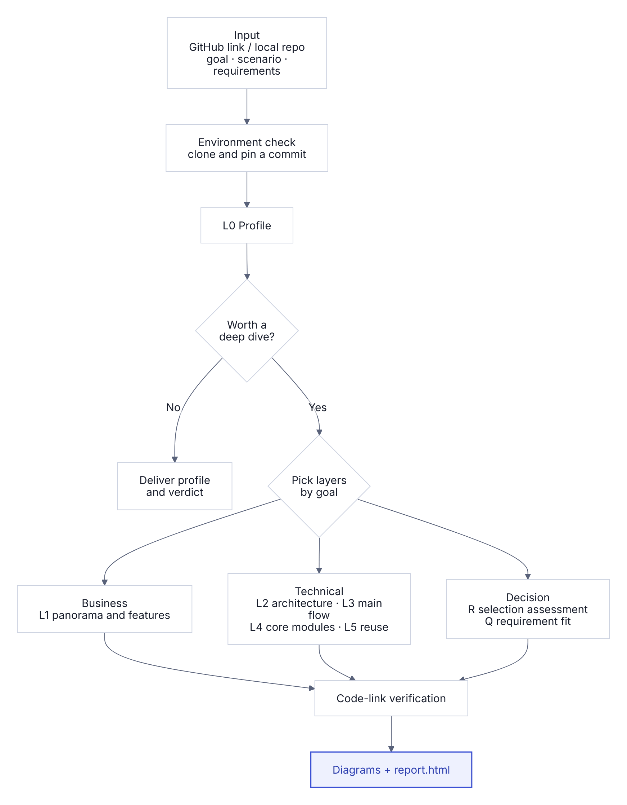

# repo-dissect

[简体中文](README.zh-CN.md) · English

An agent skill for dissecting open-source projects. Give it a GitHub link or a local repository and it analyzes the code layer by layer for your goal, producing evidence-linked Markdown documents and a single-page HTML report. Works with Codex, Claude Code, Deep Code, DeepSeek Harness and other agents that support SKILL.md. Reports are written in Chinese.


## What it does

- **Business view**: target users, usage scenarios, business panorama, feature architecture, and a feature inventory (community vs. enterprise; stable / experimental / deprecated).
- **Technical view**: modules and layers, core abstractions, main-flow call chain, design trade-offs in core modules, reuse assessment.
- **Selection assessment**: feature fit, license deep-dive, project health, security, deployment and localization / offline constraints, alternatives, with a recommend / conditional / not-recommended verdict.
- **Requirement-fit matrix**: given a requirement list or tender document, rates each item as met / partially met / needs custom development / enterprise only / not met.
- **Traceable**: every claim links to code lines at a pinned commit and is marked ✅ fact / 🔍 inference / ❓ unconfirmed; links are verified automatically before delivery.
- **Run and screenshot with one choice**: checks whether this machine can run the project (Docker, images, memory, ports, host permissions the project asks for) and shows a decision card; after you choose once, it starts the project, screenshots the feature pages and cleans up. When the current environment can't run it (e.g. a cloud sandbox), it writes a one-line prompt to hand off to the agent on your own computer.
- **Safe**: instructions aimed at AI inside the analyzed repo are never executed; secrets are never copied; the project runs only in containers, from a copy of the code, with a time limit, and cleanup removes only what this run created.

## Workflow

<p align="center"></p>

| Goal | Layers |
| --- | --- |
| Selection assessment | L0 → L1 → L2 → R |
| Multi-project comparison | L0 + L1 + L2 + R per repo → comparison tables |
| Product reference | L0 → L1 → reusable design cards |
| Architecture study / tutorial | L0 → L4 |
| Secondary development, module extraction | L0 → L5 |
| With a requirement list | any of the above + Q requirement-fit matrix |

## Install

### One-line install

Send this to your agent:

```text
Install the skill repo-dissect from https://github.com/ReyYoung/repo-dissect, then run scripts/check_env.py to verify it and tell me the install path.
```

### Manual install

```bash
git clone https://github.com/ReyYoung/repo-dissect.git && cd repo-dissect

# Codex / Deep Code / DeepSeek Harness
mkdir -p ~/.agents/skills/repo-dissect && cp -R SKILL.md agents references scripts assets ~/.agents/skills/repo-dissect/

# Claude Code
mkdir -p ~/.claude/skills/repo-dissect && cp -R SKILL.md references scripts assets ~/.claude/skills/repo-dissect/
```

Restart the agent if it does not pick up the skill right away.

## Usage

```text
Use $repo-dissect to dissect https://github.com/infiniflow/ragflow for a selection assessment.
Scenario: on-premises delivery to a client, domestic-stack compliance, offline intranet deployment. Requirements: ./requirements.xlsx
```

In Claude Code use `/repo-dissect`, or just describe the task. The agent asks for any missing parameters in one go; when unattended it uses defaults and records them in `index.md`.

## Example: RAGFlow selection assessment

The full output is in [examples/ragflow](examples/ragflow/). Download [report.html](examples/ragflow/report.html) and open it in a browser.

**Business panorama** — one row per scenario: who uses it, what they do, which capabilities and external systems it depends on.


**Feature architecture** — capabilities by layer; core capabilities highlighted, enterprise-only capabilities in a dashed group.


**Requirement-fit matrix** — verdict, matching feature, code evidence and effort for each requirement.


Verdict: **conditionally recommended**. Of 28 sample requirements: 10 met, 12 partially met, 3 enterprise only, 1 needs custom development, 2 to be verified; about 800 code links verified.

## Output files

| File | Contents |
| --- | --- |
| `report.html` | Summary report in a single file, works offline; diagrams downloadable as SVG / PNG; printable to PDF |
| `index.md` | Analyzed version, method, defaults used, link-check result |
| `00-画像.md` … `07-需求响应矩阵.md` | Per-layer analysis documents |
| `img/` | Diagram SVGs and their data files |

## Requirements

- git, Python 3.8+ (scripts use the standard library only; nothing to install)
- Optional: `gh`, `rg`, Docker with Compose v2 (to run the project and take screenshots; on a Mac, OrbStack or Docker Desktop, started automatically if not running), Playwright (screenshots, report checks, and pre-rendering flow diagrams as static images). Missing tools are handled with fallbacks; run `scripts/check_env.py` to see what you have.
- Reports work fully offline: every diagram is packed into `report.html` and nothing is loaded from the network, which suits intranet delivery.

## Known limitations

- Large multi-container projects cannot be started without enough resources or registry access: the run card then suggests handing off to the agent on your computer, or the analysis stays static and the report says so.
- Performance requirements cannot be confirmed from code; they are marked unconfirmed with a load-test suggestion.
- Results support decisions; review key evidence before delivering to a client.

## License

[MIT License](LICENSE). RAGFlow code and names referenced in the example belong to their respective owners.
