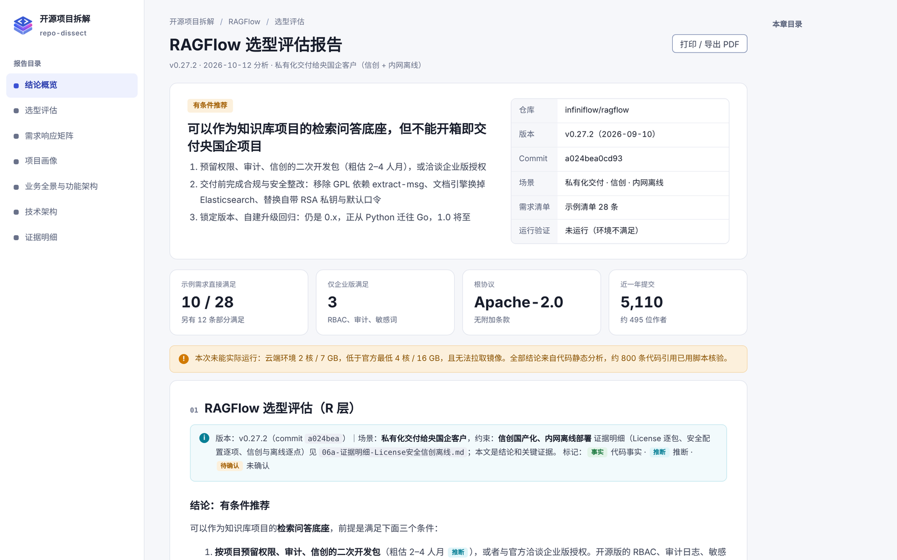
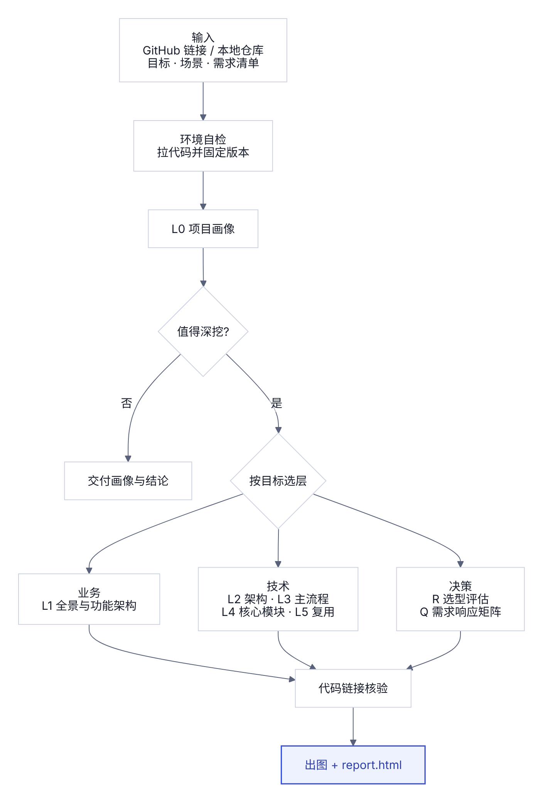
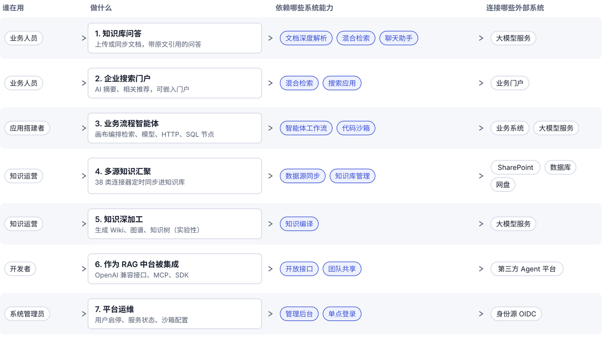
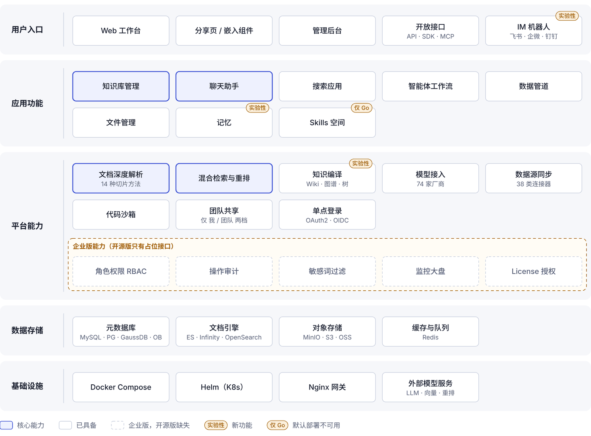
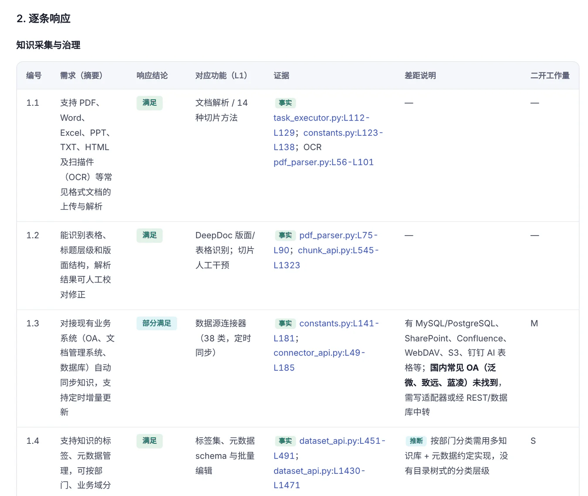

# repo-dissect

简体中文 · [English](README.md)

一个用 AI Agent 拆解开源项目的 Skill。给它一个 GitHub 链接或本地仓库，它会按目标逐层分析，产出带代码证据的 Markdown 文档和一页可直接打开的 HTML 报告。适用于 Codex、Claude Code、Deep Code、DeepSeek Harness 等支持 SKILL.md 的 Agent。



## 能做什么

- **业务视角**：目标用户、使用场景、业务全景图、功能架构图、功能清单（区分社区版 / 企业版、稳定 / 实验性 / 已废弃）。
- **技术视角**：模块与分层、核心抽象、主流程调用链、核心模块精读（先列机制候选表讲清为什么选它；每个模块写清输入输出、核心机制、失败边界、设计取舍、适用条件和技术债）、复用评估。
- **选型评估**：功能匹配、License 深查、项目健康度、安全、部署运维与信创 / 离线约束、替代方案，给出推荐 / 有条件推荐 / 不推荐。
- **需求响应矩阵**：提供需求清单或招标文件时，逐条判断满足 / 部分满足 / 需二次开发 / 仅企业版满足 / 不满足。
- **结论可追溯**：每条结论链接到固定 commit 的代码行，标注 ✅ 事实 / 🔍 推断 / ❓ 待确认，交付前自动核验链接；关键结论逐条自检"源码能否证明、有无反例"，没坐实的汇总成待确认清单。
- **网络不好也能取码**：GitHub 慢或连不上时，自动换成整包下载或逐文件下载，并按固定 commit 逐文件校验；能发现本机代理（只对本次命令生效），也支持你自己配置的镜像。
- **运行截图，只需选一次**：先检查本机能否跑起来（Docker、镜像、内存、端口、项目要求的主机权限），给出一张运行决策卡片；你选定后，自动启动、按功能清单截图、结束后清理。当前环境跑不了（如云端沙箱）时，生成一句接力指令，交给你电脑上的 Agent 运行。
- **安全**：被拆仓库里写给 AI 的指令一律不执行；不抄录密钥；项目只在容器里、用代码副本运行，全程限时，只清理本次创建的资源。

## 工作流程

<p align="center"></p>

| 目标 | 执行的层级 |
| --- | --- |
| 选型评估 | L0 → L1 → L2 → R |
| 多项目对比 | 每个仓库 L0 + L1 + L2 + R → 对比表 |
| 产品与方案参考 | L0 → L1 → 可借鉴设计 |
| 架构学习 / 写教程 | L0 → L4 |
| 二次开发、模块抽取 | L0 → L5 |
| 附带需求清单 | 以上任一目标 + Q 需求响应矩阵 |

## 安装

### 一句话安装

在 Agent 对话框里发送：

```text
请从 https://github.com/ReyYoung/repo-dissect 安装 Skill，名称为 repo-dissect；安装完成后运行 scripts/check_env.py 校验，并告诉我安装路径。
```

### 手动安装

```bash
git clone https://github.com/ReyYoung/repo-dissect.git && cd repo-dissect

# Codex / Deep Code / DeepSeek Harness
mkdir -p ~/.agents/skills/repo-dissect && cp -R SKILL.md VERSION agents references scripts assets ~/.agents/skills/repo-dissect/

# Claude Code
mkdir -p ~/.claude/skills/repo-dissect && cp -R SKILL.md VERSION references scripts assets ~/.claude/skills/repo-dissect/
```

如果 Agent 没有立即识别，重启一次即可。

### 更新

技能不会自动更新。每次拆解开始时，环境自检会对比 GitHub 上的最新版本，有新版本就提醒你（只提醒，不会自动下载）。更新时在 Agent 对话框里发送：

```text
从 https://github.com/ReyYoung/repo-dissect 更新 repo-dissect 技能到最新版，覆盖原来的安装目录，然后运行 scripts/check_env.py 校验，并告诉我版本号。
```

不想检查更新时，设置环境变量 `RD_NO_UPDATE_CHECK=1`。

## 使用方法

```text
使用 $repo-dissect 拆解 https://github.com/infiniflow/ragflow ，目标是选型评估。
场景：私有化交付给客户，要求信创国产化、内网离线部署。需求清单见 ./需求清单.xlsx
```

Claude Code 中用 `/repo-dissect`，也可以直接用自然语言描述任务。缺少的参数 Agent 会一次问完；无人值守时使用默认值，并写进 `index.md`。大仓库会先做全景（L0–L2），再把值得精读的机制列成候选表请你选，Agent 不会替你决定精读哪个模块，除非你明确说"你来挑"。

## 成果示例：RAGFlow 选型评估

完整成果见 [examples/ragflow](examples/ragflow/)，下载 [report.html](examples/ragflow/report.html) 用浏览器打开即可查看。

**业务全景图**：每行一个使用场景，从角色到依赖的能力、连接的外部系统。



**功能架构图**：分层展示能力，核心能力高亮，企业版能力用虚线分组。



**需求响应矩阵**：逐条给出结论、对应功能、代码证据和二开工作量。



本例结论：**有条件推荐**。28 条示例需求中，满足 10 条、部分满足 12 条、仅企业版满足 3 条、需二次开发 1 条、待验证 2 条；共核验约 800 条代码链接。

## 输出文件

| 文件 | 内容 |
| --- | --- |
| `report.html` | 汇总报告，单文件，离线可看；图表可下载 SVG / PNG，可打印成 PDF |
| `index.md` | 分析版本、方法、默认值、链接核验结果 |
| `00-画像.md` … `07-需求响应矩阵.md` | 各层分析文档 |
| `img/` | 图表 SVG 及其数据文件 |

## 运行要求

- git、Python 3.8+（脚本只用标准库，无需安装依赖）
- 可选：`gh`、`rg`、Docker 和 Compose v2（运行项目并截图；Mac 用 OrbStack 或 Docker Desktop，没开会自动启动）、Playwright（截图、报告自查，并把流程图预渲染成静态图）。缺少时自动降级，可先运行 `scripts/check_env.py` 查看。
- 报告完全离线可看：所有图表都打包在 `report.html` 里，不加载任何外部资源，适合内网交付；手机上也能查目录、横滑看宽表。
- 访问 GitHub：直连或开代理即可（`check_env.py` 会测连接速度、证书和失效的代理设置，不会改你的配置，也不会关闭证书校验）。有自己信任的 GitHub 镜像时设置 `RD_GITHUB_MIRROR`；本 Skill 不内置第三方镜像地址。实在连不上，可以用项目在 Gitee / GitCode 上的官方镜像、浏览器下载的源码 ZIP，或本地仓库路径。

## 已知限制

- 大型多容器项目在资源不足或无法拉取镜像的环境里跑不起来：运行卡片会建议交给你电脑上的 Agent，或只做静态分析并在报告中注明。
- 性能类需求无法从代码确认，会标为待确认并给出压测建议。
- 用整包或逐文件下载取到的代码没有提交历史，热点文件统计和 `git blame` 做不了，设计取舍的证据改查 GitHub API，报告里会注明。
- 结论用于辅助决策，交付客户前请人工复核关键证据。

## 更新记录

见 [CHANGELOG.zh-CN.md](CHANGELOG.zh-CN.md)（[English](CHANGELOG.md)）。

## 许可证

[MIT License](LICENSE)。示例中引用的 RAGFlow 代码和名称归其各自权利人所有。
