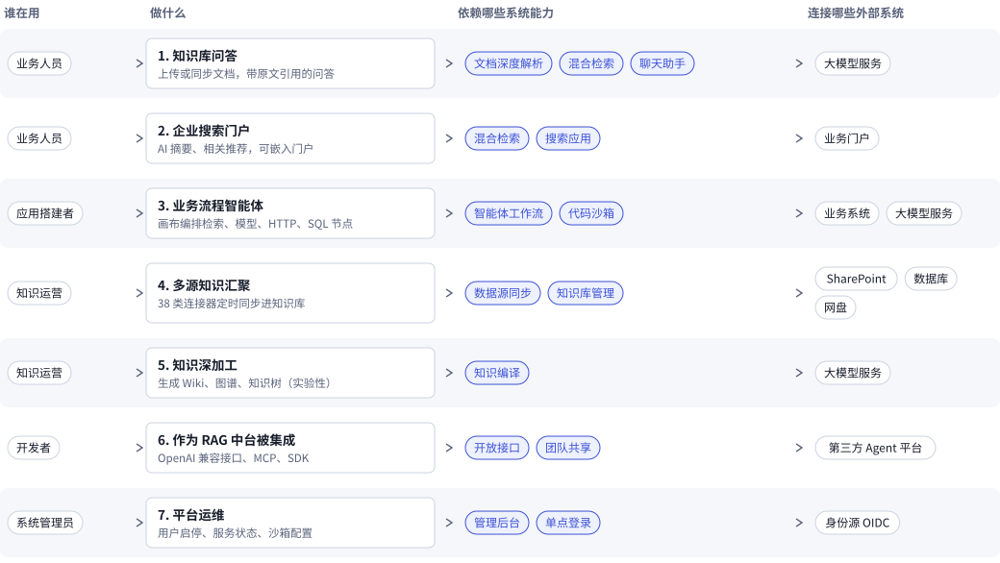
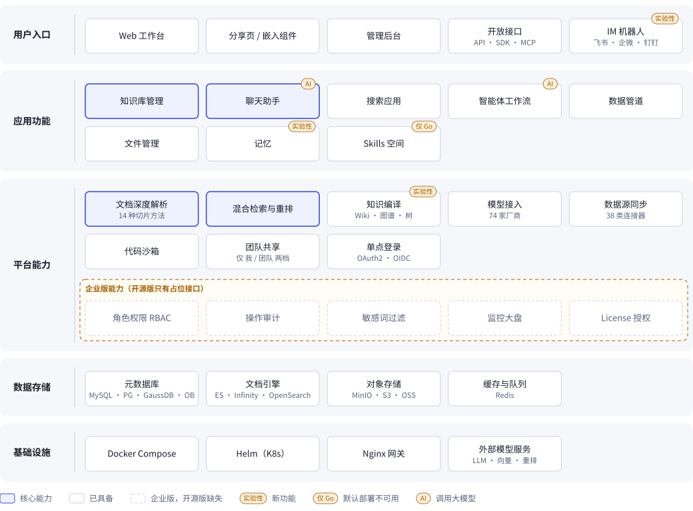
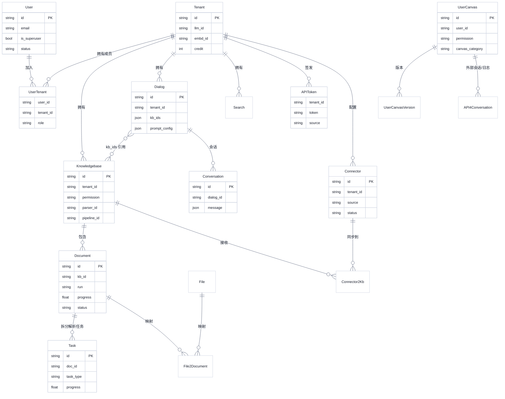
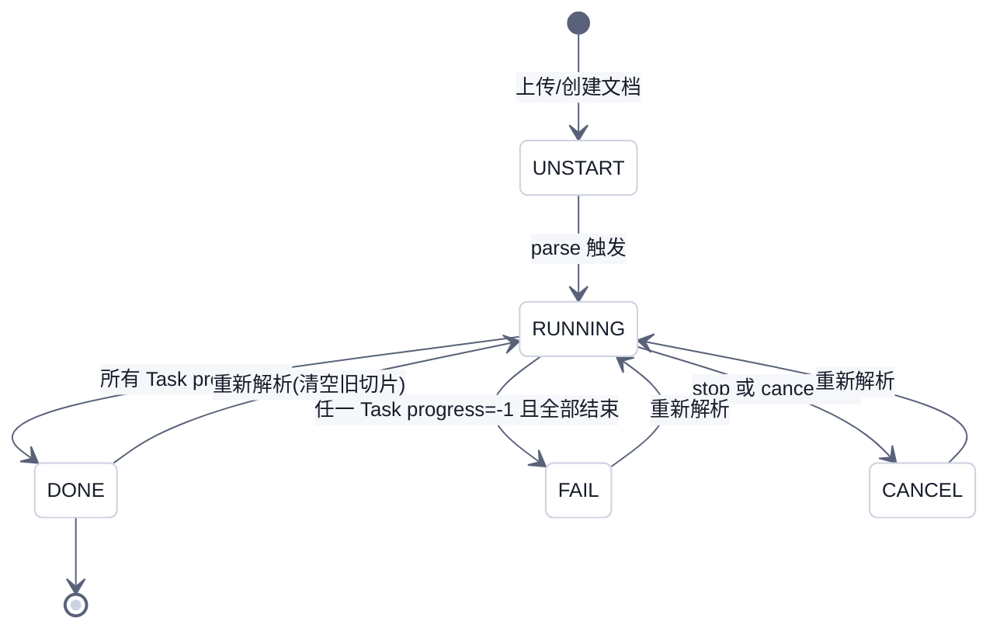
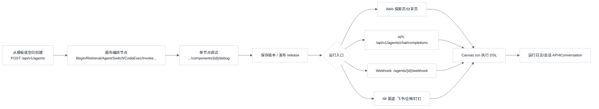

# RAGFlow 业务全景与功能架构（选型评估 · 产品/售前视角）

> 分析对象：infiniflow/ragflow，tag `v0.27.2`，commit `a024bea0cd93f39e6652a42bf84dd20c55bc560b`
> 分析口径：默认部署形态（`API_PROXY_SCHEME=python`，Python 后端 + React 前端）。Go 后端独有的能力单独标注"仅 Go 后端"。
> 证据标记：✅ 代码事实；🔍 推断或来自文档；❓ 未确认。所有行号都来自本次 `grep -n`/`sed -n` 的实际输出。
> 永久链接前缀：`https://github.com/infiniflow/ragflow/blob/a024bea0cd93f39e6652a42bf84dd20c55bc560b/`

默认部署形态的证据：✅ [docker/.env:L249-L251](https://github.com/infiniflow/ragflow/blob/a024bea0cd93f39e6652a42bf84dd20c55bc560b/docker/.env#L249-L251)（`API_PROXY_SCHEME=python`）。在这个模式下，Nginx 把 `/api/v1/admin` 转到 9381（Python Admin），其他 `/v1|/api` 请求都转到 9380（Python API）。✅ [docker/nginx/ragflow.conf.python:L13-L21](https://github.com/infiniflow/ragflow/blob/a024bea0cd93f39e6652a42bf84dd20c55bc560b/docker/nginx/ragflow.conf.python#L13-L21)

---

## 1. 业务全景

### 1.1 目标用户与角色

| 角色 | 典型人群 | 在系统里的身份 | 主要诉求 | 出处 |
|---|---|---|---|---|
| 终端用户（业务人员/知识消费者） | 一线员工、客服、研究人员 | 普通注册用户；通过分享链接或嵌入页访问的匿名访客 | 用自然语言问答、检索，答案要能追溯到原文引用 | ✅ 分享/嵌入页免登录路由 [web/src/routes.tsx:L138-L152](https://github.com/infiniflow/ragflow/blob/a024bea0cd93f39e6652a42bf84dd20c55bc560b/web/src/routes.tsx#L138-L152) |
| 知识运营/应用搭建者 | 知识管理员、业务 BA、AI 应用工程师 | 租户 Owner（每个注册用户自动拥有一个同 ID 的租户）或团队成员 `normal` | 建知识库、配置解析方法、调检索参数、搭聊天助手、搭 Agent 工作流 | ✅ 注册时创建同 ID 租户并设为 OWNER [api/apps/restful_apis/user_api.py:L428-L445](https://github.com/infiniflow/ragflow/blob/a024bea0cd93f39e6652a42bf84dd20c55bc560b/api/apps/restful_apis/user_api.py#L428-L445) |
| 系统管理员 | 平台运维/IT 管理员 | `User.is_superuser=True`，登录独立的 Admin 控制台 | 用户启停、服务状态、沙箱配置、日志级别 | ✅ [admin/server/auth.py:L304-L314](https://github.com/infiniflow/ragflow/blob/a024bea0cd93f39e6652a42bf84dd20c55bc560b/admin/server/auth.py#L304-L314)；[api/db/db_models.py:L1116](https://github.com/infiniflow/ragflow/blob/a024bea0cd93f39e6652a42bf84dd20c55bc560b/api/db/db_models.py#L1116) |
| 开发者/集成方 | 集成商、ISV、内部研发 | 持租户级 API Key 调用 HTTP API、SDK 或 MCP | 把 RAG 能力嵌进现有业务系统或其他 Agent 平台 | ✅ API Key 管理 [api/apps/restful_apis/system_api.py:L275-L373](https://github.com/infiniflow/ragflow/blob/a024bea0cd93f39e6652a42bf84dd20c55bc560b/api/apps/restful_apis/system_api.py#L275-L373) |
| 运维 | 部署实施人员 | Docker Compose / Helm 部署者 | 选型组件（文档引擎、元数据库、对象存储）、离线部署、扩容 | ✅ [docker/.env:L13-L25](https://github.com/infiniflow/ragflow/blob/a024bea0cd93f39e6652a42bf84dd20c55bc560b/docker/.env#L13-L25)；[helm/](https://github.com/infiniflow/ragflow/tree/a024bea0cd93f39e6652a42bf84dd20c55bc560b/helm)（目录） |

### 1.2 核心使用场景

1. **企业知识库问答（RAG 主场景）**：上传或同步文档，按文档类型选择切片方法完成深度解析，再配置聊天助手做带引用的问答。✅ 涉及的 API 有 [chat_api.py:L1240](https://github.com/infiniflow/ragflow/blob/a024bea0cd93f39e6652a42bf84dd20c55bc560b/api/apps/restful_apis/chat_api.py#L1240)、[document_api.py:L1541](https://github.com/infiniflow/ragflow/blob/a024bea0cd93f39e6652a42bf84dd20c55bc560b/api/apps/restful_apis/document_api.py#L1541)
2. **企业搜索门户**：搜索应用提供 AI 摘要、相关问题推荐、思维导图，可以分享或嵌入网页。✅ [search_api.py:L200-L201](https://github.com/infiniflow/ragflow/blob/a024bea0cd93f39e6652a42bf84dd20c55bc560b/api/apps/restful_apis/search_api.py#L200-L201)、[bot_api.py:L310-L560](https://github.com/infiniflow/ragflow/blob/a024bea0cd93f39e6652a42bf84dd20c55bc560b/api/apps/restful_apis/bot_api.py#L310-L560)
3. **业务流程智能体（Agent 工作流）**：在画布上编排检索、LLM、分类、循环、代码执行、HTTP 调用、SQL 等节点，支持版本发布、Webhook 触发和日志追踪。✅ [web/src/constants/agent.tsx:L84-L141](https://github.com/infiniflow/ragflow/blob/a024bea0cd93f39e6652a42bf84dd20c55bc560b/web/src/constants/agent.tsx#L84-L141)、[agent_api.py:L1829-L1834](https://github.com/infiniflow/ragflow/blob/a024bea0cd93f39e6652a42bf84dd20c55bc560b/api/apps/restful_apis/agent_api.py#L1829-L1834)
4. **多源知识汇聚**：通过 38 类数据源连接器定时同步外部系统内容到知识库，也有 IM 渠道把问答推送到飞书、企业微信、钉钉等。✅ [common/constants.py:L141-L181](https://github.com/infiniflow/ragflow/blob/a024bea0cd93f39e6652a42bf84dd20c55bc560b/common/constants.py#L141-L181)、[api/channels/bootstrap.py:L39-L48](https://github.com/infiniflow/ragflow/blob/a024bea0cd93f39e6652a42bf84dd20c55bc560b/api/channels/bootstrap.py#L39-L48)
5. **知识工程深加工**：包括知识编译（Wiki、Graph、Tree、Page Index、思维导图、时间线、Skills 生成）。旧的 GraphRAG 和 RAPTOR 已在 v0.27.0 废弃，界面里不再提供，由知识编译里的 Graph、Tree 取代，旧数据仍可检索（✅ [docs/release_notes.md:L95](https://github.com/infiniflow/ragflow/blob/a024bea0cd93f39e6652a42bf84dd20c55bc560b/docs/release_notes.md#L95)）。✅ [api/apps/services/dataset_api_service.py:L53](https://github.com/infiniflow/ragflow/blob/a024bea0cd93f39e6652a42bf84dd20c55bc560b/api/apps/services/dataset_api_service.py#L53)
6. **作为 RAG 中台被集成**：对外提供 OpenAI 兼容接口、Dify 外部知识库接口、MCP Server 和 Python SDK。✅ [openai_api.py:L237](https://github.com/infiniflow/ragflow/blob/a024bea0cd93f39e6652a42bf84dd20c55bc560b/api/apps/restful_apis/openai_api.py#L237)、[dify_retrieval_api.py:L111](https://github.com/infiniflow/ragflow/blob/a024bea0cd93f39e6652a42bf84dd20c55bc560b/api/apps/restful_apis/dify_retrieval_api.py#L111)

### 1.3 价值主张

- **深度文档理解**：内置 14 种领域切片方法（通用、论文、书籍、法律、手册、问答、表格、简历、图片、演示文稿、整篇、音频、邮件、标签）。✅ [rag/svr/task_executor.py:L112-L129](https://github.com/infiniflow/ragflow/blob/a024bea0cd93f39e6652a42bf84dd20c55bc560b/rag/svr/task_executor.py#L112-L129)。版式识别默认用 ONNX，也可以切到昇腾。✅ [deepdoc/parser/pdf_parser.py:L75-L89](https://github.com/infiniflow/ragflow/blob/a024bea0cd93f39e6652a42bf84dd20c55bc560b/deepdoc/parser/pdf_parser.py#L75-L89)
- **答案可溯源**：对话里 `quote` 开关会插入引用。✅ [api/db/services/dialog_service.py:L704](https://github.com/infiniflow/ragflow/blob/a024bea0cd93f39e6652a42bf84dd20c55bc560b/api/db/services/dialog_service.py#L704)；`Dialog.do_refer` 字段 [db_models.py:L1482](https://github.com/infiniflow/ragflow/blob/a024bea0cd93f39e6652a42bf84dd20c55bc560b/api/db/db_models.py#L1482)
- **模型中立**：预置 74 个模型厂商，其中包括通义、智谱、DeepSeek、文心、混元、讯飞星火，以及 Ollama、vLLM、Xinference、GPUStack 等本地推理框架。✅ [conf/llm_factories.json:L575](https://github.com/infiniflow/ragflow/blob/a024bea0cd93f39e6652a42bf84dd20c55bc560b/conf/llm_factories.json#L575)（Tongyi-Qianwen）、[L1825](https://github.com/infiniflow/ragflow/blob/a024bea0cd93f39e6652a42bf84dd20c55bc560b/conf/llm_factories.json#L1825)（Ollama）、[L1863](https://github.com/infiniflow/ragflow/blob/a024bea0cd93f39e6652a42bf84dd20c55bc560b/conf/llm_factories.json#L1863)（VLLM）、[L4678](https://github.com/infiniflow/ragflow/blob/a024bea0cd93f39e6652a42bf84dd20c55bc560b/conf/llm_factories.json#L4678)（BaiduYiyan）。74 这个数是用脚本统计 `factory_llm_infos` 得到的。
- **组件可替换**：文档引擎可选 ES、Infinity、OceanBase、OpenSearch、SeekDB、GaussDB；元数据库可选 MySQL、PostgreSQL、GaussDB、OceanBase。✅ [docker/.env:L13-L25](https://github.com/infiniflow/ragflow/blob/a024bea0cd93f39e6652a42bf84dd20c55bc560b/docker/.env#L13-L25)
- **开源许可**：Apache-2.0。✅ 源码文件头，例如 [web/src/routes.tsx:L5-L14](https://github.com/infiniflow/ragflow/blob/a024bea0cd93f39e6652a42bf84dd20c55bc560b/web/src/routes.tsx#L5-L14)

### 1.4 业务全景图

*图 1：RAGFlow 覆盖 7 类使用场景，问答和检索是共同底座。数据源：`img/业务全景.json`。*

---

## 2. 功能架构图

*图 2：五层架构中，解析和检索是核心能力；平台层的权限、审计、敏感词等企业级管控在开源版只有占位接口。数据源：`img/功能架构.json`。*

---

## 3. 功能清单

| 一级模块 | 二级功能 | 说明 | 入口（页面/API） | 出处 | 版本归属 | 成熟度 |
|---|---|---|---|---|---|---|
| 工作台导航 | 顶部主导航 | 首页、知识库、聊天、搜索、智能体、记忆、文件管理 | 全局 Navbar | ✅ [global-navbar.tsx:L38-L79](https://github.com/infiniflow/ragflow/blob/a024bea0cd93f39e6652a42bf84dd20c55bc560b/web/src/layouts/components/global-navbar.tsx#L38-L79) | 社区版 | 稳定 |
| 知识库 | 知识库增删改查 | 创建、列表、更新、删除 Dataset | `/datasets`；`POST/GET/PUT/DELETE /api/v1/datasets` | ✅ [dataset_api.py:L82-L318](https://github.com/infiniflow/ragflow/blob/a024bea0cd93f39e6652a42bf84dd20c55bc560b/api/apps/restful_apis/dataset_api.py#L82-L318) | 社区版 | 稳定 |
| 知识库 | 共享范围 | `permission`：只有我（me）或团队（team） | 知识库配置页 | ✅ [db_models.py:L1270](https://github.com/infiniflow/ragflow/blob/a024bea0cd93f39e6652a42bf84dd20c55bc560b/api/db/db_models.py#L1270)；[zh.ts:L685-L686](https://github.com/infiniflow/ragflow/blob/a024bea0cd93f39e6652a42bf84dd20c55bc560b/web/src/locales/zh.ts#L685-L686) | 社区版 | 稳定 |
| 知识库 | 切片方法配置 | 14 种领域解析器 + `parser_config` | 知识库配置 `/dataset/configuration/:id` | ✅ [common/constants.py:L123-L138](https://github.com/infiniflow/ragflow/blob/a024bea0cd93f39e6652a42bf84dd20c55bc560b/common/constants.py#L123-L138)；[zh.ts:L695-L785](https://github.com/infiniflow/ragflow/blob/a024bea0cd93f39e6652a42bf84dd20c55bc560b/web/src/locales/zh.ts#L695-L785) | 社区版 | 稳定 |
| 知识库 | 标签集/标签 | Tag 知识库可作为标签集给其他库打标，支持标签聚合 | `/api/v1/datasets/<id>/tags` | ✅ [dataset_api.py:L451-L491](https://github.com/infiniflow/ragflow/blob/a024bea0cd93f39e6652a42bf84dd20c55bc560b/api/apps/restful_apis/dataset_api.py#L451-L491)；[zh.ts:L785](https://github.com/infiniflow/ragflow/blob/a024bea0cd93f39e6652a42bf84dd20c55bc560b/web/src/locales/zh.ts#L785) | 社区版 | 稳定 |
| 知识库 | 元数据配置与批量编辑 | 知识库级元数据 schema、文档元数据批量更新和汇总 | `/api/v1/datasets/<id>/metadata/*` | ✅ [dataset_api.py:L1430-L1471](https://github.com/infiniflow/ragflow/blob/a024bea0cd93f39e6652a42bf84dd20c55bc560b/api/apps/restful_apis/dataset_api.py#L1430-L1471)；[document_api.py:L316-L359](https://github.com/infiniflow/ragflow/blob/a024bea0cd93f39e6652a42bf84dd20c55bc560b/api/apps/restful_apis/document_api.py#L316-L359) | 社区版 | 稳定 |
| 知识库 | 页面排名/自动关键词/自动问题 | 召回加权、切片增强 | 配置页 | ✅ [zh.ts:L550-L552](https://github.com/infiniflow/ragflow/blob/a024bea0cd93f39e6652a42bf84dd20c55bc560b/web/src/locales/zh.ts#L550-L552)、[L832](https://github.com/infiniflow/ragflow/blob/a024bea0cd93f39e6652a42bf84dd20c55bc560b/web/src/locales/zh.ts#L832) | 社区版 | 稳定 |
| 知识库 | 摄取日志 | 知识库和文件级处理日志（PipelineOperationLog） | `/dataset/logs/:id`；`/api/v1/datasets/<id>/ingestions` | ✅ [dataset_api.py:L1387-L1413](https://github.com/infiniflow/ragflow/blob/a024bea0cd93f39e6652a42bf84dd20c55bc560b/api/apps/restful_apis/dataset_api.py#L1387-L1413)；[db_models.py:L1679-L1702](https://github.com/infiniflow/ragflow/blob/a024bea0cd93f39e6652a42bf84dd20c55bc560b/api/db/db_models.py#L1679-L1702) | 社区版 | 稳定 |
| 文档解析 | 上传文档 | 本地上传到知识库 | `POST /api/v1/datasets/<id>/documents`、`/documents/upload` | ✅ [document_api.py:L121](https://github.com/infiniflow/ragflow/blob/a024bea0cd93f39e6652a42bf84dd20c55bc560b/api/apps/restful_apis/document_api.py#L121)、[L441](https://github.com/infiniflow/ragflow/blob/a024bea0cd93f39e6652a42bf84dd20c55bc560b/api/apps/restful_apis/document_api.py#L441) | 社区版 | 稳定 |
| 文档解析 | 解析/停止解析 | 入队解析任务，可取消 | `POST .../documents/parse`、`.../documents/stop` | ✅ [document_api.py:L1541-L1661](https://github.com/infiniflow/ragflow/blob/a024bea0cd93f39e6652a42bf84dd20c55bc560b/api/apps/restful_apis/document_api.py#L1541-L1661) | 社区版 | 稳定 |
| 文档解析 | 启用/禁用文档 | 批量更新文档状态 | `.../documents/batch-update-status` | ✅ [document_api.py:L1973](https://github.com/infiniflow/ragflow/blob/a024bea0cd93f39e6652a42bf84dd20c55bc560b/api/apps/restful_apis/document_api.py#L1973) | 社区版 | 稳定 |
| 文档解析 | 文档预览/原文查看 | 原文预览和图片访问 | `/document/:id`；`/api/v1/documents/<id>/preview` | ✅ [routes.tsx:L157-L161](https://github.com/infiniflow/ragflow/blob/a024bea0cd93f39e6652a42bf84dd20c55bc560b/web/src/routes.tsx#L157-L161)；[document_api.py:L2094](https://github.com/infiniflow/ragflow/blob/a024bea0cd93f39e6652a42bf84dd20c55bc560b/api/apps/restful_apis/document_api.py#L2094) | 社区版 | 稳定 |
| 文档解析 | 切片人工干预 | 切片列表、新增、编辑、删除 | `/chunk/chunk/:id`；`.../chunks` | ✅ [chunk_api.py:L545-L1323](https://github.com/infiniflow/ragflow/blob/a024bea0cd93f39e6652a42bf84dd20c55bc560b/api/apps/restful_apis/chunk_api.py#L545-L1323) | 社区版 | 稳定 |
| 文档解析 | 文档结构图 | 单文档结构图生成和删除 | `.../structure/graph` | ✅ [chunk_api.py:L666-L1023](https://github.com/infiniflow/ragflow/blob/a024bea0cd93f39e6652a42bf84dd20c55bc560b/api/apps/restful_apis/chunk_api.py#L666-L1023) | 社区版 | 🔍 实验性（新功能） |
| 检索 | 检索测试 | 调阈值、权重，查看召回结果 | `/dataset/retrieval/:id`；`POST /api/v1/retrieval` | ✅ [routes.tsx:L208-L211](https://github.com/infiniflow/ragflow/blob/a024bea0cd93f39e6652a42bf84dd20c55bc560b/web/src/routes.tsx#L208-L211)；[chunk_api.py:L333-L335](https://github.com/infiniflow/ragflow/blob/a024bea0cd93f39e6652a42bf84dd20c55bc560b/api/apps/restful_apis/chunk_api.py#L333-L335) | 社区版 | 稳定 |
| 检索 | 混合检索与重排 | 向量相似度权重、相似度阈值、rerank、top_k | 聊天/搜索配置 | ✅ [rag/nlp/search.py:L593](https://github.com/infiniflow/ragflow/blob/a024bea0cd93f39e6652a42bf84dd20c55bc560b/rag/nlp/search.py#L593)；[db_models.py:L1474-L1485](https://github.com/infiniflow/ragflow/blob/a024bea0cd93f39e6652a42bf84dd20c55bc560b/api/db/db_models.py#L1474-L1485) | 社区版 | 稳定 |
| 检索 | 元数据过滤 | 按文档元数据限定检索范围 | 聊天配置 `meta_data_filter` | ✅ [dialog_service.py:L665-L667](https://github.com/infiniflow/ragflow/blob/a024bea0cd93f39e6652a42bf84dd20c55bc560b/api/db/services/dialog_service.py#L665-L667) | 社区版 | 稳定 |
| 知识增强 | GraphRAG 知识图谱 | 构建和查看实体关系图 | `/dataset/knowledge-graph/:id`；`POST .../index?type=graph` | ✅ [routes.tsx:L212-L215](https://github.com/infiniflow/ragflow/blob/a024bea0cd93f39e6652a42bf84dd20c55bc560b/web/src/routes.tsx#L212-L215)；[dataset_api.py:L1302-L1309](https://github.com/infiniflow/ragflow/blob/a024bea0cd93f39e6652a42bf84dd20c55bc560b/api/apps/restful_apis/dataset_api.py#L1302-L1309) | 社区版 | 已废弃（v0.27.0 起界面不再提供，旧数据可检索，🔍 接口仍在）[docs/release_notes.md:L95](https://github.com/infiniflow/ragflow/blob/a024bea0cd93f39e6652a42bf84dd20c55bc560b/docs/release_notes.md#L95) |
| 知识增强 | RAPTOR 分层摘要 | 递归聚类摘要，增强召回 | 同上 `type=raptor` | ✅ [dataset_api_service.py:L53-L57](https://github.com/infiniflow/ragflow/blob/a024bea0cd93f39e6652a42bf84dd20c55bc560b/api/apps/services/dataset_api_service.py#L53-L57)；[zh.ts:L795](https://github.com/infiniflow/ragflow/blob/a024bea0cd93f39e6652a42bf84dd20c55bc560b/web/src/locales/zh.ts#L795) | 社区版 | 已废弃（v0.27.0 起界面不再提供，旧数据可检索，🔍 接口仍在）[docs/release_notes.md:L95](https://github.com/infiniflow/ragflow/blob/a024bea0cd93f39e6652a42bf84dd20c55bc560b/docs/release_notes.md#L95) |
| 知识增强 | 知识编译（Artifact/Wiki） | 按编译模板从文档生成 Entity/Concept/Topic 页面，支持编辑和提交历史 | `/dataset/compilation/:id`；`.../artifacts/*` | ✅ [routes.tsx:L344-L347](https://github.com/infiniflow/ragflow/blob/a024bea0cd93f39e6652a42bf84dd20c55bc560b/web/src/routes.tsx#L344-L347)；[dataset_api.py:L539-L1250](https://github.com/infiniflow/ragflow/blob/a024bea0cd93f39e6652a42bf84dd20c55bc560b/api/apps/restful_apis/dataset_api.py#L539-L1250)；[zh.ts:L417-L418](https://github.com/infiniflow/ragflow/blob/a024bea0cd93f39e6652a42bf84dd20c55bc560b/web/src/locales/zh.ts#L417-L418) | 社区版 | 🔍 实验性 |
| 知识增强 | 编译模板管理 | 模板分组（file/dataset 作用域）、内置模板 | `/compilation-templates/edit-next`；`/api/v1/compilation-template-groups` | ✅ [compilation_template_group_api.py:L69-L163](https://github.com/infiniflow/ragflow/blob/a024bea0cd93f39e6652a42bf84dd20c55bc560b/api/apps/restful_apis/compilation_template_group_api.py#L69-L163)；[db_models.py:L1603-L1628](https://github.com/infiniflow/ragflow/blob/a024bea0cd93f39e6652a42bf84dd20c55bc560b/api/db/db_models.py#L1603-L1628) | 社区版 | 🔍 实验性 |
| 知识增强 | 知识库生成 Skills | 从数据集构建分层 Skills 树 | `.../index?type=skill`；`.../skills` | ✅ [dataset_api.py:L890-L1209](https://github.com/infiniflow/ragflow/blob/a024bea0cd93f39e6652a42bf84dd20c55bc560b/api/apps/restful_apis/dataset_api.py#L890-L1209)；[zh.ts:L419-L420](https://github.com/infiniflow/ragflow/blob/a024bea0cd93f39e6652a42bf84dd20c55bc560b/web/src/locales/zh.ts#L419-L420) | 社区版 | 🔍 实验性 |
| 聊天助手 | 助手配置 | 绑定知识库、选 LLM、提示词、开场白、空回复 | `/chats`；`/api/v1/chats` | ✅ [chat_api.py:L417-L785](https://github.com/infiniflow/ragflow/blob/a024bea0cd93f39e6652a42bf84dd20c55bc560b/api/apps/restful_apis/chat_api.py#L417-L785)；[db_models.py:L1454-L1490](https://github.com/infiniflow/ragflow/blob/a024bea0cd93f39e6652a42bf84dd20c55bc560b/api/db/db_models.py#L1454-L1490) | 社区版 | 稳定 |
| 聊天助手 | 会话与问答 | 多会话、流式回答、带引用 | `/chat/:id`；`POST /api/v1/chat/completions` | ✅ [chat_api.py:L832-L1240](https://github.com/infiniflow/ragflow/blob/a024bea0cd93f39e6652a42bf84dd20c55bc560b/api/apps/restful_apis/chat_api.py#L832-L1240) | 社区版 | 稳定 |
| 聊天助手 | 高级问答开关 | 多轮优化、关键词分析、推理、联网搜索、跨语言、知识图谱、TOC 增强 | 助手配置 | ✅ [dialog_service.py:L736-L783](https://github.com/infiniflow/ragflow/blob/a024bea0cd93f39e6652a42bf84dd20c55bc560b/api/db/services/dialog_service.py#L736-L783)；[zh.ts:L1083-L1117](https://github.com/infiniflow/ragflow/blob/a024bea0cd93f39e6652a42bf84dd20c55bc560b/web/src/locales/zh.ts#L1083-L1117) | 社区版 | 稳定 |
| 聊天助手 | 点赞点踩反馈 | 消息级反馈 | `.../messages/<id>/feedback` | ✅ [chat_api.py:L1025](https://github.com/infiniflow/ragflow/blob/a024bea0cd93f39e6652a42bf84dd20c55bc560b/api/apps/restful_apis/chat_api.py#L1025) | 社区版 | 稳定 |
| 聊天助手 | 语音输入/朗读 | ASR 转写、TTS | `/api/v1/chat/audio/*` | ✅ [chat_api.py:L1092-L1120](https://github.com/infiniflow/ragflow/blob/a024bea0cd93f39e6652a42bf84dd20c55bc560b/api/apps/restful_apis/chat_api.py#L1092-L1120) | 社区版 | 稳定 |
| 聊天助手 | 分享/嵌入网站 | 全屏或浮窗 widget，生成 iframe 代码 | `/chats/share`、`/chats/widget` | ✅ [routes.tsx:L138-L152](https://github.com/infiniflow/ragflow/blob/a024bea0cd93f39e6652a42bf84dd20c55bc560b/web/src/routes.tsx#L138-L152)；[embed-dialog/index.tsx:L68-L79](https://github.com/infiniflow/ragflow/blob/a024bea0cd93f39e6652a42bf84dd20c55bc560b/web/src/components/embed-dialog/index.tsx#L68-L79) | 社区版 | 稳定 |
| 搜索应用 | 搜索应用配置与问答 | 摘要、高亮、相关搜索、思维导图、联网 | `/searches`、`/search/:id`；`/api/v1/searches` | ✅ [search_api.py:L43-L201](https://github.com/infiniflow/ragflow/blob/a024bea0cd93f39e6652a42bf84dd20c55bc560b/api/apps/restful_apis/search_api.py#L43-L201)；[db_models.py:L1638-L1668](https://github.com/infiniflow/ragflow/blob/a024bea0cd93f39e6652a42bf84dd20c55bc560b/api/db/db_models.py#L1638-L1668) | 社区版 | 稳定 |
| 搜索应用 | 分享/嵌入 | 免登录 searchbot 接口 | `/search/share`；`/api/v1/searchbots/*` | ✅ [bot_api.py:L310-L560](https://github.com/infiniflow/ragflow/blob/a024bea0cd93f39e6652a42bf84dd20c55bc560b/api/apps/restful_apis/bot_api.py#L310-L560) | 社区版 | 稳定 |
| 智能体 | 画布编排 | 前端 `Operator` 枚举共 56 项（含数据管道节点），包括：检索、LLM/Agent、分类、Switch、循环、迭代、代码、HTTP Invoke、SQL、邮件、浏览器、文档生成等 | `/agent/:id` | ✅ [web/src/constants/agent.tsx:L84-L141](https://github.com/infiniflow/ragflow/blob/a024bea0cd93f39e6652a42bf84dd20c55bc560b/web/src/constants/agent.tsx#L84-L141)；[agent/component/](https://github.com/infiniflow/ragflow/tree/a024bea0cd93f39e6652a42bf84dd20c55bc560b/agent/component)（目录） | 社区版 | 稳定 |
| 智能体 | 模板库 | 19 个内置模板（客服、深度研究、Text2SQL 等） | `/agent-templates`；`GET /api/v1/agents/templates` | ✅ [agent_api.py:L647](https://github.com/infiniflow/ragflow/blob/a024bea0cd93f39e6652a42bf84dd20c55bc560b/api/apps/restful_apis/agent_api.py#L647)；[agent/templates/](https://github.com/infiniflow/ragflow/tree/a024bea0cd93f39e6652a42bf84dd20c55bc560b/agent/templates)（目录，19 个 json） | 社区版 | 稳定 |
| 智能体 | 版本与发布 | 保存版本、发布（release）、按发布版本运行 | `.../versions` | ✅ [agent_api.py:L1116-L1131](https://github.com/infiniflow/ragflow/blob/a024bea0cd93f39e6652a42bf84dd20c55bc560b/api/apps/restful_apis/agent_api.py#L1116-L1131)；[db_models.py:L1576-L1586](https://github.com/infiniflow/ragflow/blob/a024bea0cd93f39e6652a42bf84dd20c55bc560b/api/db/db_models.py#L1576-L1586) | 社区版 | 稳定 |
| 智能体 | 调试与运行日志 | 单节点调试、运行轨迹日志、会话 | `/agent-log-page/:id`；`.../debug`、`.../logs` | ✅ [agent_api.py:L1035-L1145](https://github.com/infiniflow/ragflow/blob/a024bea0cd93f39e6652a42bf84dd20c55bc560b/api/apps/restful_apis/agent_api.py#L1035-L1145) | 社区版 | 稳定 |
| 智能体 | Webhook 触发 | Begin 节点设为 Webhook 模式后，外部系统可触发 | `/api/v1/agents/<id>/webhook` | ✅ [agent_api.py:L1829-L1834](https://github.com/infiniflow/ragflow/blob/a024bea0cd93f39e6652a42bf84dd20c55bc560b/api/apps/restful_apis/agent_api.py#L1829-L1834)；[begin.py:L30](https://github.com/infiniflow/ragflow/blob/a024bea0cd93f39e6652a42bf84dd20c55bc560b/agent/component/begin.py#L30) | 社区版 | 稳定 |
| 智能体 | 分享/探索 | 免登录分享页、探索页会话 | `/agent/share`、`/agent/:id/explore` | ✅ [routes.tsx:L143-L147](https://github.com/infiniflow/ragflow/blob/a024bea0cd93f39e6652a42bf84dd20c55bc560b/web/src/routes.tsx#L143-L147)、[L355-L358](https://github.com/infiniflow/ragflow/blob/a024bea0cd93f39e6652a42bf84dd20c55bc560b/web/src/routes.tsx#L355-L358) | 社区版 | 稳定 |
| 智能体 | 代码沙箱 | CodeExec 节点在隔离容器执行 Python/Node 代码 | Admin `/admin/sandbox-settings` | ✅ [docker/.env:L353-L379](https://github.com/infiniflow/ragflow/blob/a024bea0cd93f39e6652a42bf84dd20c55bc560b/docker/.env#L353-L379)；[admin/server/routes.py:L554-L628](https://github.com/infiniflow/ragflow/blob/a024bea0cd93f39e6652a42bf84dd20c55bc560b/admin/server/routes.py#L554-L628) | 社区版 | 稳定（默认关闭） |
| 数据管道 | Ingestion Pipeline | 用画布编排 File→Parser→Chunker→Extractor→Compiler→Tokenizer | 知识库配置选择 pipeline | ✅ [db_models.py:L1548](https://github.com/infiniflow/ragflow/blob/a024bea0cd93f39e6652a42bf84dd20c55bc560b/api/db/db_models.py#L1548)（`dataflow_canvas`）；[document_service.py:L1242-L1246](https://github.com/infiniflow/ragflow/blob/a024bea0cd93f39e6652a42bf84dd20c55bc560b/api/db/services/document_service.py#L1242-L1246) | 社区版 | 稳定 |
| 记忆 | Agent 记忆库 | raw/semantic/episodic/procedural 记忆，遗忘策略 FIFO | `/memories`；`/api/v1/memories`、`/messages` | ✅ [memory_api.py:L30-L331](https://github.com/infiniflow/ragflow/blob/a024bea0cd93f39e6652a42bf84dd20c55bc560b/api/apps/restful_apis/memory_api.py#L30-L331)；[db_models.py:L1810-L1832](https://github.com/infiniflow/ragflow/blob/a024bea0cd93f39e6652a42bf84dd20c55bc560b/api/db/db_models.py#L1810-L1832) | 社区版 | 🔍 实验性 |
| 文件管理 | 文件夹/文件 | 个人文件空间，可以链接到知识库 | `/files`；`/api/v1/files`、`/files/link-to-datasets` | ✅ [file_api.py:L45-L348](https://github.com/infiniflow/ragflow/blob/a024bea0cd93f39e6652a42bf84dd20c55bc560b/api/apps/restful_apis/file_api.py#L45-L348)；[file2document_api.py:L98](https://github.com/infiniflow/ragflow/blob/a024bea0cd93f39e6652a42bf84dd20c55bc560b/api/apps/restful_apis/file2document_api.py#L98) | 社区版 | 稳定 |
| 文件管理 | 文件提交/版本 | 类 git 的 commit、diff、文件版本 | `.../commits`、`/workspace-files/<id>/versions` | ✅ [file_commit_api.py:L119-L381](https://github.com/infiniflow/ragflow/blob/a024bea0cd93f39e6652a42bf84dd20c55bc560b/api/apps/restful_apis/file_commit_api.py#L119-L381) | 社区版 | 🔍 实验性 |
| Skills 空间 | Skills 空间与检索 | 创建 Skills 空间、索引、搜索 | `/files/skills`；`/api/v1/skills/*` | ✅ Go 路由 [internal/router/router.go:L528-L547](https://github.com/infiniflow/ragflow/blob/a024bea0cd93f39e6652a42bf84dd20c55bc560b/internal/router/router.go#L528-L547)；Python 侧无对应路由（`grep` `/skills` 只命中 `datasets/<id>/skills`） | 仅 Go 后端 | 🔍 默认 Python 部署下页面可见但接口 404 |
| 数据源 | 连接器管理 | 新增、测试、日志、重建、定时同步，可关联多个知识库 | `/user-setting/data-source`；`/api/v1/connectors` | ✅ [connector_api.py:L49-L185](https://github.com/infiniflow/ragflow/blob/a024bea0cd93f39e6652a42bf84dd20c55bc560b/api/apps/restful_apis/connector_api.py#L49-L185)；[db_models.py:L1705-L1732](https://github.com/infiniflow/ragflow/blob/a024bea0cd93f39e6652a42bf84dd20c55bc560b/api/db/db_models.py#L1705-L1732) | 社区版 | 稳定 |
| 数据源 | 38 类连接器 | Confluence、SharePoint、Notion、S3、WebDAV、Seafile、MySQL/PG、钉钉 AI 表格等 | 同上 | ✅ [common/constants.py:L141-L181](https://github.com/infiniflow/ragflow/blob/a024bea0cd93f39e6652a42bf84dd20c55bc560b/common/constants.py#L141-L181)；[data-source/constant/index.tsx:L36-L75](https://github.com/infiniflow/ragflow/blob/a024bea0cd93f39e6652a42bf84dd20c55bc560b/web/src/pages/user-setting/data-source/constant/index.tsx#L36-L75) | 社区版 | 稳定 |
| 聊天渠道 | IM 机器人 | 把 Chat/Agent 接到飞书、企微、钉钉、QQ、Discord、Telegram、LINE、WhatsApp | `/user-setting/chat-channel`；`/api/v1/chat-channels` | ✅ [chat_channel_api.py:L35-L147](https://github.com/infiniflow/ragflow/blob/a024bea0cd93f39e6652a42bf84dd20c55bc560b/api/apps/restful_apis/chat_channel_api.py#L35-L147)；[bootstrap.py:L39-L48](https://github.com/infiniflow/ragflow/blob/a024bea0cd93f39e6652a42bf84dd20c55bc560b/api/channels/bootstrap.py#L39-L48) | 社区版 | 🔍 实验性 |
| 模型管理 | 模型提供商/实例/模型 | 多实例、多模型类型（chat/embedding/asr/vision/rerank/tts/ocr） | `/user-setting/model`；`/api/v1/providers` | ✅ [provider_api.py:L30-L1041](https://github.com/infiniflow/ragflow/blob/a024bea0cd93f39e6652a42bf84dd20c55bc560b/api/apps/restful_apis/provider_api.py#L30-L1041)；[common/constants.py:L86-L93](https://github.com/infiniflow/ragflow/blob/a024bea0cd93f39e6652a42bf84dd20c55bc560b/common/constants.py#L86-L93) | 社区版 | 稳定 |
| 模型管理 | 默认模型 | 租户级默认 LLM、Embedding、Rerank 等 | `/api/v1/models/default` | ✅ [models_api.py:L107-L162](https://github.com/infiniflow/ragflow/blob/a024bea0cd93f39e6652a42bf84dd20c55bc560b/api/apps/restful_apis/models_api.py#L107-L162) | 社区版 | 稳定 |
| MCP | MCP 客户端（工具接入） | 注册外部 MCP Server（sse/streamable-http）给 Agent 用 | `/user-setting/mcp`；`/api/v1/mcp/servers` | ✅ [mcp_api.py:L70-L328](https://github.com/infiniflow/ragflow/blob/a024bea0cd93f39e6652a42bf84dd20c55bc560b/api/apps/restful_apis/mcp_api.py#L70-L328)；[common/constants.py:L221-L223](https://github.com/infiniflow/ragflow/blob/a024bea0cd93f39e6652a42bf84dd20c55bc560b/common/constants.py#L221-L223) | 社区版 | 稳定 |
| MCP | MCP Server（能力输出） | 提供 `ragflow_retrieval` 等工具，self-host/host 两种模式 | 独立进程 :9382 | ✅ [mcp/server/server.py:L546-L639](https://github.com/infiniflow/ragflow/blob/a024bea0cd93f39e6652a42bf84dd20c55bc560b/mcp/server/server.py#L546-L639)；默认未启用 [docker-compose.yml:L23-L31](https://github.com/infiniflow/ragflow/blob/a024bea0cd93f39e6652a42bf84dd20c55bc560b/docker/docker-compose.yml#L23-L31) | 社区版 | 稳定（需手工开启） |
| 团队与账号 | 注册/登录/找回密码 | 邮箱注册（可关闭）、OTP 找回 | `/login`；`/api/v1/auth/*` | ✅ [user_api.py:L62-L819](https://github.com/infiniflow/ragflow/blob/a024bea0cd93f39e6652a42bf84dd20c55bc560b/api/apps/restful_apis/user_api.py#L62-L819)；[docker/.env:L340-L344](https://github.com/infiniflow/ragflow/blob/a024bea0cd93f39e6652a42bf84dd20c55bc560b/docker/.env#L340-L344) | 社区版 | 稳定 |
| 团队与账号 | OAuth2/OIDC/GitHub 登录 | 在配置文件声明渠道 | `/api/v1/auth/login/<channel>` | ✅ [api/apps/auth/__init__.py:L22-L36](https://github.com/infiniflow/ragflow/blob/a024bea0cd93f39e6652a42bf84dd20c55bc560b/api/apps/auth/__init__.py#L22-L36)；[conf/service_conf.yaml:L141-L163](https://github.com/infiniflow/ragflow/blob/a024bea0cd93f39e6652a42bf84dd20c55bc560b/conf/service_conf.yaml#L141-L163) | 社区版 | 稳定（默认注释未启用） |
| 团队与账号 | 团队邀请/加入/退出 | Owner 邀请已注册用户，被邀请人同意后成为 normal | `/user-setting/team`；`/api/v1/tenants/*` | ✅ [tenant_api.py:L41-L173](https://github.com/infiniflow/ragflow/blob/a024bea0cd93f39e6652a42bf84dd20c55bc560b/api/apps/restful_apis/tenant_api.py#L41-L173)；[zh.ts:L1829-L1837](https://github.com/infiniflow/ragflow/blob/a024bea0cd93f39e6652a42bf84dd20c55bc560b/web/src/locales/zh.ts#L1829-L1837) | 社区版 | 稳定 |
| 开放接口 | API Key | 租户级密钥的创建和删除 | `/user-setting/api`；`/api/v1/system/tokens` | ✅ [system_api.py:L275-L373](https://github.com/infiniflow/ragflow/blob/a024bea0cd93f39e6652a42bf84dd20c55bc560b/api/apps/restful_apis/system_api.py#L275-L373) | 社区版 | 稳定 |
| 开放接口 | OpenAI 兼容 / Dify 兼容 | 对话和检索的兼容协议 | `/api/v1/openai/<chat_id>/chat/completions`、`/dify/retrieval` | ✅ [openai_api.py:L237](https://github.com/infiniflow/ragflow/blob/a024bea0cd93f39e6652a42bf84dd20c55bc560b/api/apps/restful_apis/openai_api.py#L237)；[dify_retrieval_api.py:L111](https://github.com/infiniflow/ragflow/blob/a024bea0cd93f39e6652a42bf84dd20c55bc560b/api/apps/restful_apis/dify_retrieval_api.py#L111) | 社区版 | 稳定 |
| 开放接口 | Python SDK | 覆盖 dataset/chat/agent/memory/retrieve | `ragflow_sdk.RAGFlow` | ✅ [sdk/python/ragflow_sdk/ragflow.py:L27-L392](https://github.com/infiniflow/ragflow/blob/a024bea0cd93f39e6652a42bf84dd20c55bc560b/sdk/python/ragflow_sdk/ragflow.py#L27-L392) | 社区版 | 稳定 |
| 系统管理 | 用户管理 | 列表、新建、删除、改密码、启停、授予/撤销超管 | `/admin/users`；Admin `/users*` | ✅ [admin/server/routes.py:L67-L231](https://github.com/infiniflow/ragflow/blob/a024bea0cd93f39e6652a42bf84dd20c55bc560b/admin/server/routes.py#L67-L231) | 社区版 | 稳定 |
| 系统管理 | 服务状态 | 各组件健康状态（重启/停止未实现） | `/admin/services` | ✅ [admin/server/routes.py:L234-L278](https://github.com/infiniflow/ragflow/blob/a024bea0cd93f39e6652a42bf84dd20c55bc560b/admin/server/routes.py#L234-L278)；[admin/server/services.py:L342-L346](https://github.com/infiniflow/ragflow/blob/a024bea0cd93f39e6652a42bf84dd20c55bc560b/admin/server/services.py#L342-L346) | 社区版 | 部分占位 |
| 系统管理 | 使用统计 | PV/UV/Token/轮次/点赞（按租户统计） | `/api/v1/system/stats` | ✅ [stats_api.py:L24-L47](https://github.com/infiniflow/ragflow/blob/a024bea0cd93f39e6652a42bf84dd20c55bc560b/api/apps/restful_apis/stats_api.py#L24-L47) | 社区版 | 只有后端无界面（🔍 未在路由中找到独立页面） |
| 可观测 | Langfuse 接入 | 租户级 Langfuse key | `/api/v1/langfuse/api-key` | ✅ [langfuse_api.py:L26-L85](https://github.com/infiniflow/ragflow/blob/a024bea0cd93f39e6652a42bf84dd20c55bc560b/api/apps/restful_apis/langfuse_api.py#L26-L85) | 社区版 | 稳定 |
| 企业版占位 | 角色/RBAC | 角色增删改、授权、用户角色、角色默认模型 | `/admin/roles`（仅 `VITE_RAGFLOW_ENTERPRISE` 构建可见） | ✅ Python：[admin/server/roles.py:L23-L76](https://github.com/infiniflow/ragflow/blob/a024bea0cd93f39e6652a42bf84dd20c55bc560b/admin/server/roles.py#L23-L76)（`not implement`）；Go：[service_ee.go:L37-L180](https://github.com/infiniflow/ragflow/blob/a024bea0cd93f39e6652a42bf84dd20c55bc560b/internal/admin/service_ee.go#L37-L180)（`not supported`）；前端开关 [routes.tsx:L423-L438](https://github.com/infiniflow/ragflow/blob/a024bea0cd93f39e6652a42bf84dd20c55bc560b/web/src/routes.tsx#L423-L438) | 企业版(开源版仅占位) | 占位未实现 |
| 企业版占位 | 白名单/监控 | 注册白名单、监控大盘 | `/admin/whitelist`、`/admin/monitoring` | ✅ [service_ee.go:L1257-L1313](https://github.com/infiniflow/ragflow/blob/a024bea0cd93f39e6652a42bf84dd20c55bc560b/internal/admin/service_ee.go#L1257-L1313)；[web/src/pages/admin/utils.tsx:L79-L80](https://github.com/infiniflow/ragflow/blob/a024bea0cd93f39e6652a42bf84dd20c55bc560b/web/src/pages/admin/utils.tsx#L79-L80) | 企业版(开源版仅占位) | 占位未实现 |
| 企业版占位 | 操作日志/Token 统计 | 审计日志、API Token 用量统计 | Go Admin `/logs`、`/stats/token*` | ✅ [router_ee.go:L83-L88](https://github.com/infiniflow/ragflow/blob/a024bea0cd93f39e6652a42bf84dd20c55bc560b/internal/admin/router_ee.go#L83-L88)；[service_ee.go:L1319-L1366](https://github.com/infiniflow/ragflow/blob/a024bea0cd93f39e6652a42bf84dd20c55bc560b/internal/admin/service_ee.go#L1319-L1366) | 企业版(开源版仅占位) | 占位未实现 |
| 企业版占位 | License/指纹 | 系统授权、软指纹 | Go Admin `/system/license` | ✅ [service_ee.go:L363-L419](https://github.com/infiniflow/ragflow/blob/a024bea0cd93f39e6652a42bf84dd20c55bc560b/internal/admin/service_ee.go#L363-L419)；[license_ee.go:L19-L21](https://github.com/infiniflow/ragflow/blob/a024bea0cd93f39e6652a42bf84dd20c55bc560b/internal/admin/license_ee.go#L19-L21) | 企业版(开源版仅占位) | 占位未实现 |
| 企业版占位 | 敏感词/验证邮箱 | 敏感词上传下载、SMTP 验证邮箱 | Go Admin `/sensitive-words`、`/email/verification` | ✅ [service_ee.go:L1209-L1251](https://github.com/infiniflow/ragflow/blob/a024bea0cd93f39e6652a42bf84dd20c55bc560b/internal/admin/service_ee.go#L1209-L1251) | 企业版(开源版仅占位) | 占位未实现 |
| 企业版占位 | 飞书/Azure/ICBC 等 SSO（Go） | Go 侧专用登录回调 | `/auth/oauth/lark/callback`、`/auth/icbc/callback` 等 | ✅ [internal/router/router_ee.go:L26-L39](https://github.com/infiniflow/ragflow/blob/a024bea0cd93f39e6652a42bf84dd20c55bc560b/internal/router/router_ee.go#L26-L39)；[internal/handler/user_auth_ee.go:L25-L79](https://github.com/infiniflow/ragflow/blob/a024bea0cd93f39e6652a42bf84dd20c55bc560b/internal/handler/user_auth_ee.go#L25-L79)（全部 `not implemented`） | 企业版(开源版仅占位) | 占位未实现 |

---

## 4. 核心业务对象

| 实体 | 中文含义 | 模型定义出处 |
|---|---|---|
| User | 用户账号（含超管标记） | ✅ [api/db/db_models.py:L1095-L1138](https://github.com/infiniflow/ragflow/blob/a024bea0cd93f39e6652a42bf84dd20c55bc560b/api/db/db_models.py#L1095-L1138) |
| Tenant | 租户/团队空间（ID 与创建者 User ID 相同），保存默认模型 | ✅ [db_models.py:L1141-L1167](https://github.com/infiniflow/ragflow/blob/a024bea0cd93f39e6652a42bf84dd20c55bc560b/api/db/db_models.py#L1141-L1167) |
| UserTenant | 用户与租户的成员关系及角色 | ✅ [db_models.py:L1170-L1179](https://github.com/infiniflow/ragflow/blob/a024bea0cd93f39e6652a42bf84dd20c55bc560b/api/db/db_models.py#L1170-L1179) |
| Knowledgebase | 知识库（Dataset） | ✅ [db_models.py:L1259-L1315](https://github.com/infiniflow/ragflow/blob/a024bea0cd93f39e6652a42bf84dd20c55bc560b/api/db/db_models.py#L1259-L1315) |
| Document | 知识库中的文档及其解析状态 | ✅ [db_models.py:L1318-L1345](https://github.com/infiniflow/ragflow/blob/a024bea0cd93f39e6652a42bf84dd20c55bc560b/api/db/db_models.py#L1318-L1345) |
| Task | 文档解析/增强任务（按页拆分） | ✅ [db_models.py:L1428-L1451](https://github.com/infiniflow/ragflow/blob/a024bea0cd93f39e6652a42bf84dd20c55bc560b/api/db/db_models.py#L1428-L1451) |
| File / File2Document | 文件管理中的文件，以及它与知识库文档的映射 | ✅ [db_models.py:L1348-L1371](https://github.com/infiniflow/ragflow/blob/a024bea0cd93f39e6652a42bf84dd20c55bc560b/api/db/db_models.py#L1348-L1371) |
| Dialog | 聊天助手（检索与提示词配置） | ✅ [db_models.py:L1454-L1490](https://github.com/infiniflow/ragflow/blob/a024bea0cd93f39e6652a42bf84dd20c55bc560b/api/db/db_models.py#L1454-L1490) |
| Conversation | 聊天会话 | ✅ [db_models.py:L1493-L1502](https://github.com/infiniflow/ragflow/blob/a024bea0cd93f39e6652a42bf84dd20c55bc560b/api/db/db_models.py#L1493-L1502) |
| Search | 搜索应用 | ✅ [db_models.py:L1631-L1676](https://github.com/infiniflow/ragflow/blob/a024bea0cd93f39e6652a42bf84dd20c55bc560b/api/db/db_models.py#L1631-L1676) |
| UserCanvas / UserCanvasVersion | Agent/数据管道画布及其版本 | ✅ [db_models.py:L1538-L1586](https://github.com/infiniflow/ragflow/blob/a024bea0cd93f39e6652a42bf84dd20c55bc560b/api/db/db_models.py#L1538-L1586) |
| API4Conversation | 经 API、分享页或 Agent 产生的会话（含 token、耗时、点赞） | ✅ [db_models.py:L1517-L1535](https://github.com/infiniflow/ragflow/blob/a024bea0cd93f39e6652a42bf84dd20c55bc560b/api/db/db_models.py#L1517-L1535) |
| APIToken | 租户级 API Key / 分享 beta token | ✅ [db_models.py:L1505-L1514](https://github.com/infiniflow/ragflow/blob/a024bea0cd93f39e6652a42bf84dd20c55bc560b/api/db/db_models.py#L1505-L1514) |
| Connector / Connector2Kb | 数据源连接器及其与知识库的关联 | ✅ [db_models.py:L1705-L1732](https://github.com/infiniflow/ragflow/blob/a024bea0cd93f39e6652a42bf84dd20c55bc560b/api/db/db_models.py#L1705-L1732) |

注：表之间没有数据库外键，关联都是用 `CharField` 存 ID（例如 `Document.kb_id`、`Dialog.kb_ids` JSON），所以 ER 图里的关系是按字段语义推出来的。🔍

---

## 5. 关键业务流程

### 5.1 建知识库 → 上传文档 → 解析切片 → 检索问答

出处：✅ 入队分支 [document_service.py:L1226-L1246](https://github.com/infiniflow/ragflow/blob/a024bea0cd93f39e6652a42bf84dd20c55bc560b/api/db/services/document_service.py#L1226-L1246)；`queue_tasks` [task_service.py:L444](https://github.com/infiniflow/ragflow/blob/a024bea0cd93f39e6652a42bf84dd20c55bc560b/api/db/services/task_service.py#L444)；`queue_dataflow` [task_service.py:L648](https://github.com/infiniflow/ragflow/blob/a024bea0cd93f39e6652a42bf84dd20c55bc560b/api/db/services/task_service.py#L648)；执行器 [task_executor.py:L331](https://github.com/infiniflow/ragflow/blob/a024bea0cd93f39e6652a42bf84dd20c55bc560b/rag/svr/task_executor.py#L331)、[L744](https://github.com/infiniflow/ragflow/blob/a024bea0cd93f39e6652a42bf84dd20c55bc560b/rag/svr/task_executor.py#L744)、[L1323](https://github.com/infiniflow/ragflow/blob/a024bea0cd93f39e6652a42bf84dd20c55bc560b/rag/svr/task_executor.py#L1323)、[L1443](https://github.com/infiniflow/ragflow/blob/a024bea0cd93f39e6652a42bf84dd20c55bc560b/rag/svr/task_executor.py#L1443)；索引名 [rag/nlp/search.py:L46-L47](https://github.com/infiniflow/ragflow/blob/a024bea0cd93f39e6652a42bf84dd20c55bc560b/rag/nlp/search.py#L46-L47)；问答 [dialog_service.py:L594](https://github.com/infiniflow/ragflow/blob/a024bea0cd93f39e6652a42bf84dd20c55bc560b/api/db/services/dialog_service.py#L594)。

### 5.2 文档解析状态流转（`Document.run`，值来自 `TaskStatus`）

`TaskStatus` 枚举：UNSTART="0"、RUNNING="1"、CANCEL="2"、DONE="3"、FAIL="4"、SCHEDULE="5"。✅ [common/constants.py:L106-L112](https://github.com/infiniflow/ragflow/blob/a024bea0cd93f39e6652a42bf84dd20c55bc560b/common/constants.py#L106-L112)

出处：✅ 初始 UNSTART [document_api_service.py:L120](https://github.com/infiniflow/ragflow/blob/a024bea0cd93f39e6652a42bf84dd20c55bc560b/api/apps/services/document_api_service.py#L120)；parse 置 RUNNING、重跑时清空切片 [document_api.py:L1627-L1629](https://github.com/infiniflow/ragflow/blob/a024bea0cd93f39e6652a42bf84dd20c55bc560b/api/apps/restful_apis/document_api.py#L1627-L1629)；根据任务进度汇总出 DONE/FAIL/RUNNING [document_service.py:L1127-L1135](https://github.com/infiniflow/ragflow/blob/a024bea0cd93f39e6652a42bf84dd20c55bc560b/api/db/services/document_service.py#L1127-L1135)；stop 置 CANCEL [document_api.py:L1758-L1764](https://github.com/infiniflow/ragflow/blob/a024bea0cd93f39e6652a42bf84dd20c55bc560b/api/apps/restful_apis/document_api.py#L1758-L1764)；任务取消 [task_api.py:L91-L95](https://github.com/infiniflow/ragflow/blob/a024bea0cd93f39e6652a42bf84dd20c55bc560b/api/apps/restful_apis/task_api.py#L91-L95)。`SCHEDULE` 用在 Connector/SyncLogs 同步调度（SCHEDULE→RUNNING→DONE/FAIL/CANCEL），✅ [connector_service.py:L433-L439](https://github.com/infiniflow/ragflow/blob/a024bea0cd93f39e6652a42bf84dd20c55bc560b/api/db/services/connector_service.py#L433-L439)。另外 `Document.status`（"1" 有效 / "0" 无效）表示启用或禁用，和解析状态是两个独立的维度。✅ [db_models.py:L1341-L1342](https://github.com/infiniflow/ragflow/blob/a024bea0cd93f39e6652a42bf84dd20c55bc560b/api/db/db_models.py#L1341-L1342)

### 5.3 搭建并发布 Agent 工作流

出处：✅ [agent_api.py:L923](https://github.com/infiniflow/ragflow/blob/a024bea0cd93f39e6652a42bf84dd20c55bc560b/api/apps/restful_apis/agent_api.py#L923)、[L1035](https://github.com/infiniflow/ragflow/blob/a024bea0cd93f39e6652a42bf84dd20c55bc560b/api/apps/restful_apis/agent_api.py#L1035)、[L1444](https://github.com/infiniflow/ragflow/blob/a024bea0cd93f39e6652a42bf84dd20c55bc560b/api/apps/restful_apis/agent_api.py#L1444)、[L1829](https://github.com/infiniflow/ragflow/blob/a024bea0cd93f39e6652a42bf84dd20c55bc560b/api/apps/restful_apis/agent_api.py#L1829)；发布版本读取 [agent_api.py:L479-L482](https://github.com/infiniflow/ragflow/blob/a024bea0cd93f39e6652a42bf84dd20c55bc560b/api/apps/restful_apis/agent_api.py#L479-L482)；执行引擎 [agent/canvas.py:L331](https://github.com/infiniflow/ragflow/blob/a024bea0cd93f39e6652a42bf84dd20c55bc560b/agent/canvas.py#L331)、[L431](https://github.com/infiniflow/ragflow/blob/a024bea0cd93f39e6652a42bf84dd20c55bc560b/agent/canvas.py#L431)；渠道 [db_models.py:L1735-L1749](https://github.com/infiniflow/ragflow/blob/a024bea0cd93f39e6652a42bf84dd20c55bc560b/api/db/db_models.py#L1735-L1749)。

---

## 6. 角色与权限模型

### 6.1 三层身份

| 层级 | 实现 | 出处 |
|---|---|---|
| 系统超管 | `User.is_superuser`。Admin 接口统一用 `check_admin_auth` 校验 | ✅ [admin/server/auth.py:L304-L314](https://github.com/infiniflow/ragflow/blob/a024bea0cd93f39e6652a42bf84dd20c55bc560b/admin/server/auth.py#L304-L314) |
| 租户（团队） | 每个用户注册时自动创建 `Tenant.id == User.id`，并以 OWNER 身份加入 | ✅ [user_api.py:L428-L445](https://github.com/infiniflow/ragflow/blob/a024bea0cd93f39e6652a42bf84dd20c55bc560b/api/apps/restful_apis/user_api.py#L428-L445) |
| 团队成员角色 | `UserTenantRole`：owner / admin / normal / invite | ✅ [api/db/__init__.py:L23-L27](https://github.com/infiniflow/ragflow/blob/a024bea0cd93f39e6652a42bf84dd20c55bc560b/api/db/__init__.py#L23-L27) |

- 实际在用的只有 owner、invite、normal 三个角色。邀请时写入 `INVITE`，对方同意后改成 `NORMAL`。✅ [tenant_api.py:L92](https://github.com/infiniflow/ragflow/blob/a024bea0cd93f39e6652a42bf84dd20c55bc560b/api/apps/restful_apis/tenant_api.py#L92)、[L173](https://github.com/infiniflow/ragflow/blob/a024bea0cd93f39e6652a42bf84dd20c55bc560b/api/apps/restful_apis/tenant_api.py#L173)
- `UserTenantRole.ADMIN` 虽然定义了，但全仓 `grep "UserTenantRole.ADMIN"` 在业务代码中没有命中，也就是说团队里没有"管理员"这一级。✅
- 只有 Owner 本人能管理团队成员（`current_user.id != tenant_id` 时直接拒绝）。✅ [tenant_api.py:L44](https://github.com/infiniflow/ragflow/blob/a024bea0cd93f39e6652a42bf84dd20c55bc560b/api/apps/restful_apis/tenant_api.py#L44)、[L64](https://github.com/infiniflow/ragflow/blob/a024bea0cd93f39e6652a42bf84dd20c55bc560b/api/apps/restful_apis/tenant_api.py#L64)

### 6.2 资源共享粒度

| 资源 | 共享开关 | 访问规则 | 出处 |
|---|---|---|---|
| 知识库 | `permission` = me / team | 自己的库，或所加入租户中 `permission=team` 的库，都可以访问 | ✅ [knowledgebase_service.py:L118-L128](https://github.com/infiniflow/ragflow/blob/a024bea0cd93f39e6652a42bf84dd20c55bc560b/api/db/services/knowledgebase_service.py#L118-L128)、[L569-L590](https://github.com/infiniflow/ragflow/blob/a024bea0cd93f39e6652a42bf84dd20c55bc560b/api/db/services/knowledgebase_service.py#L569-L590) |
| 知识库删除 | — | 只有创建者能删 | ✅ [knowledgebase_service.py:L157](https://github.com/infiniflow/ragflow/blob/a024bea0cd93f39e6652a42bf84dd20c55bc560b/api/db/services/knowledgebase_service.py#L157) |
| 文档 | 跟随所属知识库 | 能访问知识库就能访问其中所有文档。删除权限给 owner 和 normal | ✅ [document_service.py:L936-L955](https://github.com/infiniflow/ragflow/blob/a024bea0cd93f39e6652a42bf84dd20c55bc560b/api/db/services/document_service.py#L936-L955) |
| Agent 画布 | `permission` = me / team | 与知识库相同 | ✅ [canvas_service.py:L321-L333](https://github.com/infiniflow/ragflow/blob/a024bea0cd93f39e6652a42bf84dd20c55bc560b/api/db/services/canvas_service.py#L321-L333) |
| 记忆 | `permissions` = me / team | 与知识库相同 | ✅ [memory_api_service.py:L59](https://github.com/infiniflow/ragflow/blob/a024bea0cd93f39e6652a42bf84dd20c55bc560b/api/apps/services/memory_api_service.py#L59) |
| 文件 | 无共享开关 | 只有当文件被关联到 team 知识库时，团队成员才能间接访问 | ✅ [check_team_permission.py:L40-L59](https://github.com/infiniflow/ragflow/blob/a024bea0cd93f39e6652a42bf84dd20c55bc560b/api/common/check_team_permission.py#L40-L59) |
| API Key | 租户级 | Token 对应到租户 Owner 用户，等于拥有该租户的全部权限，不能限定作用域 | ✅ [api/apps/__init__.py:L211-L220](https://github.com/infiniflow/ragflow/blob/a024bea0cd93f39e6652a42bf84dd20c55bc560b/api/apps/__init__.py#L211-L220)；[db_models.py:L1505-L1514](https://github.com/infiniflow/ragflow/blob/a024bea0cd93f39e6652a42bf84dd20c55bc560b/api/db/db_models.py#L1505-L1514) |

结论：权限只有"我 / 团队"两档，开关粒度到知识库或画布这一级。**没有文档级 ACL，也不区分只读和可编辑**。团队成员一旦能看到 team 知识库，就可以读写其中的文档（删除只限 owner 和 normal）。🔍（依据上表代码推断）

### 6.3 多租户隔离

- **逻辑隔离**：元数据表靠 `tenant_id` 过滤。✅ 例如 [db_models.py:L1262](https://github.com/infiniflow/ragflow/blob/a024bea0cd93f39e6652a42bf84dd20c55bc560b/api/db/db_models.py#L1262)
- **向量和全文索引按租户分开**：`ragflow_{tenant_id}`。✅ [rag/nlp/search.py:L46-L47](https://github.com/infiniflow/ragflow/blob/a024bea0cd93f39e6652a42bf84dd20c55bc560b/rag/nlp/search.py#L46-L47)
- 所有租户共用同一套数据库、对象存储和文档引擎实例，没有物理隔离。🔍

### 6.4 开源版中的 RBAC 占位

- 前端 `/admin/roles`、`/admin/whitelist`、`/admin/monitoring` 三个页面只在 `VITE_RAGFLOW_ENTERPRISE === 'RAGFLOW_ENTERPRISE'` 的构建中才会注册路由。✅ [routes.tsx:L423-L438](https://github.com/infiniflow/ragflow/blob/a024bea0cd93f39e6652a42bf84dd20c55bc560b/web/src/routes.tsx#L423-L438)、[admin/utils.tsx:L79-L80](https://github.com/infiniflow/ragflow/blob/a024bea0cd93f39e6652a42bf84dd20c55bc560b/web/src/pages/admin/utils.tsx#L79-L80)
- 前端预置了权限类型 `enable/read/write/share`，但在开源后端找不到对应实现。✅ [admin/utils.tsx:L77](https://github.com/infiniflow/ragflow/blob/a024bea0cd93f39e6652a42bf84dd20c55bc560b/web/src/pages/admin/utils.tsx#L77)
- Python Admin 的角色接口有路由（[routes.py:L289-L400](https://github.com/infiniflow/ragflow/blob/a024bea0cd93f39e6652a42bf84dd20c55bc560b/admin/server/routes.py#L289-L400)），但 `RoleMgr` 的全部方法都直接抛出 `not implement`。✅ [admin/server/roles.py:L23-L76](https://github.com/infiniflow/ragflow/blob/a024bea0cd93f39e6652a42bf84dd20c55bc560b/admin/server/roles.py#L23-L76)
- Go Admin 的角色、权限、用户角色、角色默认模型、License、白名单、敏感词、操作日志、Token 统计、用户/数据监控与清理，全部返回 `'xxx' is not supported`。✅ [internal/admin/service_ee.go:L37-L1366](https://github.com/infiniflow/ragflow/blob/a024bea0cd93f39e6652a42bf84dd20c55bc560b/internal/admin/service_ee.go#L37-L1366)；路由在 [router_ee.go:L28-L152](https://github.com/infiniflow/ragflow/blob/a024bea0cd93f39e6652a42bf84dd20c55bc560b/internal/admin/router_ee.go#L28-L152)；EE 服务启动为空实现 [internal/server/server_ee.go:L40-L53](https://github.com/infiniflow/ragflow/blob/a024bea0cd93f39e6652a42bf84dd20c55bc560b/internal/server/server_ee.go#L40-L53)

---

## 7. 集成与开放能力

| 能力 | 是否具备 | 说明 | 出处 |
|---|---|---|---|
| RESTful HTTP API | ✅ 有 | 统一前缀 `/api/v1`，覆盖知识库、文档、切片、检索、聊天、搜索、Agent、记忆、文件、连接器、模型 | ✅ [api/apps/__init__.py:L349-L376](https://github.com/infiniflow/ragflow/blob/a024bea0cd93f39e6652a42bf84dd20c55bc560b/api/apps/__init__.py#L349-L376)；[api/constants.py:L20](https://github.com/infiniflow/ragflow/blob/a024bea0cd93f39e6652a42bf84dd20c55bc560b/api/constants.py#L20) |
| 旧版 API 兼容 | ✅ 有 | 旧路径（如 `run_graphrag`、`/file/*`）通过兼容层保留 | ✅ [api/apps/backward_compat.py:L91-L636](https://github.com/infiniflow/ragflow/blob/a024bea0cd93f39e6652a42bf84dd20c55bc560b/api/apps/backward_compat.py#L91-L636) |
| OpenAI 兼容 | ✅ 有 | Chat 和 Agent 都可以按 OpenAI 协议调用 | ✅ [openai_api.py:L237](https://github.com/infiniflow/ragflow/blob/a024bea0cd93f39e6652a42bf84dd20c55bc560b/api/apps/restful_apis/openai_api.py#L237)；[backward_compat.py:L108-L126](https://github.com/infiniflow/ragflow/blob/a024bea0cd93f39e6652a42bf84dd20c55bc560b/api/apps/backward_compat.py#L108-L126) |
| Dify 外部知识库 | ✅ 有 | 可作为 Dify 的外部知识库 | ✅ [dify_retrieval_api.py:L111-L315](https://github.com/infiniflow/ragflow/blob/a024bea0cd93f39e6652a42bf84dd20c55bc560b/api/apps/restful_apis/dify_retrieval_api.py#L111-L315) |
| Python SDK | ✅ 有 | `ragflow_sdk` | ✅ [sdk/python/ragflow_sdk/ragflow.py:L27-L392](https://github.com/infiniflow/ragflow/blob/a024bea0cd93f39e6652a42bf84dd20c55bc560b/sdk/python/ragflow_sdk/ragflow.py#L27-L392) |
| MCP Server | ✅ 有 | 独立进程，提供 `ragflow_retrieval`、`ragflow_list_datasets`、`ragflow_list_chats` 三个工具；默认不启用 | ✅ [mcp/server/server.py:L546-L639](https://github.com/infiniflow/ragflow/blob/a024bea0cd93f39e6652a42bf84dd20c55bc560b/mcp/server/server.py#L546-L639)、[L809-L817](https://github.com/infiniflow/ragflow/blob/a024bea0cd93f39e6652a42bf84dd20c55bc560b/mcp/server/server.py#L809-L817)；[docker/entrypoint.sh:L50](https://github.com/infiniflow/ragflow/blob/a024bea0cd93f39e6652a42bf84dd20c55bc560b/docker/entrypoint.sh#L50) |
| MCP Server（内嵌） | 仅 Go 后端 | `POST /api/v1/mcp` | ✅ [internal/router/router.go:L228-L231](https://github.com/infiniflow/ragflow/blob/a024bea0cd93f39e6652a42bf84dd20c55bc560b/internal/router/router.go#L228-L231) |
| MCP Client | ✅ 有 | Agent 可以调用外部 MCP 工具 | ✅ [mcp_api.py:L70-L328](https://github.com/infiniflow/ragflow/blob/a024bea0cd93f39e6652a42bf84dd20c55bc560b/api/apps/restful_apis/mcp_api.py#L70-L328) |
| 模型网关直通 | 仅 Go 后端 | `/embeddings`、`/rerank`、`/chat/to_model`、`/file/ocr`、`/file/parse` | ✅ [internal/router/router.go:L572-L578](https://github.com/infiniflow/ragflow/blob/a024bea0cd93f39e6652a42bf84dd20c55bc560b/internal/router/router.go#L572-L578) |
| 数据源连接器 | ✅ 有 | Python 实现 38 类（`FileSource` 中去掉 LOCAL 和 KNOWLEDGEBASE）；Go 侧有对等实现 | ✅ [common/constants.py:L141-L181](https://github.com/infiniflow/ragflow/blob/a024bea0cd93f39e6652a42bf84dd20c55bc560b/common/constants.py#L141-L181)；[common/data_source/](https://github.com/infiniflow/ragflow/tree/a024bea0cd93f39e6652a42bf84dd20c55bc560b/common/data_source)、[internal/syncer/connector/](https://github.com/infiniflow/ragflow/tree/a024bea0cd93f39e6652a42bf84dd20c55bc560b/internal/syncer/connector)（目录） |
| IM 渠道 | ✅ 有 | 飞书、钉钉、企业微信、QQ 机器人、Discord、Telegram、LINE、WhatsApp | ✅ [api/channels/bootstrap.py:L39-L48](https://github.com/infiniflow/ragflow/blob/a024bea0cd93f39e6652a42bf84dd20c55bc560b/api/channels/bootstrap.py#L39-L48) |
| SSO：OAuth2/OIDC/GitHub | ✅ 有（Python） | 在配置文件声明 `oauth` 渠道，首次登录自动注册 | ✅ [api/apps/auth/__init__.py:L22-L36](https://github.com/infiniflow/ragflow/blob/a024bea0cd93f39e6652a42bf84dd20c55bc560b/api/apps/auth/__init__.py#L22-L36)；[user_api.py:L145-L180](https://github.com/infiniflow/ragflow/blob/a024bea0cd93f39e6652a42bf84dd20c55bc560b/api/apps/restful_apis/user_api.py#L145-L180) |
| SSO：飞书/Azure/ICBC（Go） | 占位 | 全部返回 `not implemented` | ✅ [internal/handler/user_auth_ee.go:L25-L79](https://github.com/infiniflow/ragflow/blob/a024bea0cd93f39e6652a42bf84dd20c55bc560b/internal/handler/user_auth_ee.go#L25-L79) |
| LDAP / SAML / CAS | 未找到 | 在 `api/`、`common/`、`conf/`、`docker/` 中 `grep -i "ldap\|saml"` 无命中 | ✅（检索结果为空） |
| 入站 Webhook | ✅ 有 | Agent 的 Begin 节点可设为 Webhook 模式，支持 webhook 日志 | ✅ [agent_api.py:L1829-L1834](https://github.com/infiniflow/ragflow/blob/a024bea0cd93f39e6652a42bf84dd20c55bc560b/api/apps/restful_apis/agent_api.py#L1829-L1834)、[L2515](https://github.com/infiniflow/ragflow/blob/a024bea0cd93f39e6652a42bf84dd20c55bc560b/api/apps/restful_apis/agent_api.py#L2515) |
| 出站事件通知 Webhook | 未找到 | 没有发现"文档解析完成"这类系统事件回调；只能在 Agent 中用 Invoke 或 Email 节点主动调用外部系统 | 🔍 |
| 网页嵌入 / iframe | ✅ 有 | Chat 和 Agent 有全屏或浮窗 widget，搜索应用也可嵌入 | ✅ [embed-dialog/index.tsx:L262](https://github.com/infiniflow/ragflow/blob/a024bea0cd93f39e6652a42bf84dd20c55bc560b/web/src/components/embed-dialog/index.tsx#L262)、[L286](https://github.com/infiniflow/ragflow/blob/a024bea0cd93f39e6652a42bf84dd20c55bc560b/web/src/components/embed-dialog/index.tsx#L286)；[next-search/embed-app-modal.tsx](https://github.com/infiniflow/ragflow/blob/a024bea0cd93f39e6652a42bf84dd20c55bc560b/web/src/pages/next-search/embed-app-modal.tsx)（`grep "<iframe"` 命中） |
| 观测 | ✅ 有 | Langfuse（租户级）；Jaeger 作为 compose profile | ✅ [langfuse_api.py:L26](https://github.com/infiniflow/ragflow/blob/a024bea0cd93f39e6652a42bf84dd20c55bc560b/api/apps/restful_apis/langfuse_api.py#L26)；[docker/.env:L221-L222](https://github.com/infiniflow/ragflow/blob/a024bea0cd93f39e6652a42bf84dd20c55bc560b/docker/.env#L221-L222) |

---

## 8. 业务差距（场景：私有化交付给央国企，有信创和内网离线约束）

| # | 能力项 | 现状与证据 | 影响 | 补齐难度 |
|---|---|---|---|---|
| 1 | 细粒度权限 / RBAC | 只有 me/team 两档，没有部门、角色、只读/可编辑之分；团队里的 `ADMIN` 角色没有被使用；RBAC 接口在开源版是占位。✅ [knowledgebase_service.py:L118-L128](https://github.com/infiniflow/ragflow/blob/a024bea0cd93f39e6652a42bf84dd20c55bc560b/api/db/services/knowledgebase_service.py#L118-L128)；[admin/server/roles.py:L23-L76](https://github.com/infiniflow/ragflow/blob/a024bea0cd93f39e6652a42bf84dd20c55bc560b/admin/server/roles.py#L23-L76) | 没法满足"按部门、岗位分级访问知识"这一基本要求 | **L**（要改造 Service 层所有 `accessible` 判断，以及检索过滤链路） |
| 2 | 文档级 / 切片级访问控制（检索时鉴权） | 检索只按 kb_ids 加元数据过滤，没有按用户权限的 ACL 过滤。✅ [dialog_service.py:L665-L667](https://github.com/infiniflow/ragflow/blob/a024bea0cd93f39e6652a42bf84dd20c55bc560b/api/db/services/dialog_service.py#L665-L667) | 同一个知识库里密级不同的文档无法隔离，只能拆成多个库 | **L**（可以借 `meta_data_filter` 拼出"用户→可见标签"的临时方案，属于 M 级权宜） |
| 3 | 审计日志 | 业务侧没有操作审计表；Go EE 的 `ListLogs` 返回 not supported。✅ [service_ee.go:L1360-L1366](https://github.com/infiniflow/ragflow/blob/a024bea0cd93f39e6652a42bf84dd20c55bc560b/internal/admin/service_ee.go#L1360-L1366)；`PipelineOperationLog` 只记录解析过程 [db_models.py:L1679-L1702](https://github.com/infiniflow/ragflow/blob/a024bea0cd93f39e6652a42bf84dd20c55bc560b/api/db/db_models.py#L1679-L1702) | 过不了等保、安全审计和"谁查了什么"的追溯要求 | **M**（在 `login_required` 装饰器和关键 API 上加中间件写审计表，再做查询页） |
| 4 | 审批流（知识入库/发布审核） | 文档上传后直接可解析、可检索；Agent 只有 release 标记，没有审核环节。未找到 approval 相关实现（`grep -i approv` 只命中第三方连接器）。✅ [db_models.py:L1545](https://github.com/infiniflow/ragflow/blob/a024bea0cd93f39e6652a42bf84dd20c55bc560b/api/db/db_models.py#L1545) | 知识质量和合规无法把关 | **M** |
| 5 | 组织架构同步（部门/人员） | 没有部门、组织模型；用户只能自行注册或由 Admin 创建；团队邀请只支持已注册用户。✅ [zh.ts:L1830](https://github.com/infiniflow/ragflow/blob/a024bea0cd93f39e6652a42bf84dd20c55bc560b/web/src/locales/zh.ts#L1830)；[db_models.py:L1095-L1179](https://github.com/infiniflow/ragflow/blob/a024bea0cd93f39e6652a42bf84dd20c55bc560b/api/db/db_models.py#L1095-L1179) | 对接不了 4A、统一身份、HR 主数据 | **M–L**（要新增组织模型、同步任务，并和权限模型联动） |
| 6 | 单点登录 | Python 侧支持标准 OAuth2/OIDC（✅），能对接支持 OIDC 的统一认证；不支持 LDAP/AD、SAML、CAS（未找到）；Go 侧飞书、ICBC、Azure 回调都是占位。✅ [user_auth_ee.go:L33-L47](https://github.com/infiniflow/ragflow/blob/a024bea0cd93f39e6652a42bf84dd20c55bc560b/internal/handler/user_auth_ee.go#L33-L47) | 很多央国企 IAM 走的是 CAS、SAML 或私有协议 | **S–M**（OIDC 配置即可；CAS/LDAP 需要新写 OAuthClient 子类，参照 [oauth.py:L32](https://github.com/infiniflow/ragflow/blob/a024bea0cd93f39e6652a42bf84dd20c55bc560b/api/apps/auth/oauth.py#L32)） |
| 7 | 国产化适配：数据库 | 元数据库支持 GaussDB、OceanBase（✅ [db_models.py:L797-L803](https://github.com/infiniflow/ragflow/blob/a024bea0cd93f39e6652a42bf84dd20c55bc560b/api/db/db_models.py#L797-L803)），文档引擎支持 GaussDB、OceanBase（✅ [docker/.env:L13-L21](https://github.com/infiniflow/ragflow/blob/a024bea0cd93f39e6652a42bf84dd20c55bc560b/docker/.env#L13-L21)）。没有找到达梦、人大金仓、神通、瀚高（全仓 grep 无命中） | 达梦、金仓项目要自研适配 | **M**（金仓兼容 PG，可能复用 PG 方言，需要验证 ❓；达梦需要写新驱动和迁移器，属于 L） |
| 8 | 国产化适配：OS/芯片 | 镜像构建支持 aarch64（✅ [Dockerfile:L90](https://github.com/infiniflow/ragflow/blob/a024bea0cd93f39e6652a42bf84dd20c55bc560b/Dockerfile#L90)）；版式识别可切到昇腾（✅ [pdf_parser.py:L75-L86](https://github.com/infiniflow/ragflow/blob/a024bea0cd93f39e6652a42bf84dd20c55bc560b/deepdoc/parser/pdf_parser.py#L75-L86)）；有 OpenCloudOS 9 的 Dockerfile（✅ [Dockerfile.scratch.oc9:L1](https://github.com/infiniflow/ragflow/blob/a024bea0cd93f39e6652a42bf84dd20c55bc560b/Dockerfile.scratch.oc9#L1)），但对应 compose 引用的是第三方个人镜像（✅ [docker-compose-CN-oc9.yml:L14](https://github.com/infiniflow/ragflow/blob/a024bea0cd93f39e6652a42bf84dd20c55bc560b/docker/docker-compose-CN-oc9.yml#L14)）。没有麒麟、统信的适配 | 信创认证、互认证明要自己做 | **M**（主要是适配验证工作量；ARM 下 ES、MinIO 的兼容需要实测 ❓） |
| 9 | 国密 | 对象存储可选 `sm4-cbc` 加密，默认关闭（✅ [common/crypto_utils.py:L244](https://github.com/infiniflow/ragflow/blob/a024bea0cd93f39e6652a42bf84dd20c55bc560b/common/crypto_utils.py#L244)、[common/settings.py:L457-L468](https://github.com/infiniflow/ragflow/blob/a024bea0cd93f39e6652a42bf84dd20c55bc560b/common/settings.py#L457-L468)）；登录密码传输用 RSA，没有 SM2/SM3（未找到）；仓库里带有默认密钥文件 `conf/private.pem`（内容未抄录） | 密评要求 SM2/SM3、TLS 国密套件；默认密钥必须替换 | **M** |
| 10 | 数据分级分类 / 密级标识 | 没有密级字段，也没有数据分级模型（`grep security_level/密级` 无命中）；敏感词过滤在开源版是占位（✅ [service_ee.go:L1209-L1225](https://github.com/infiniflow/ragflow/blob/a024bea0cd93f39e6652a42bf84dd20c55bc560b/internal/admin/service_ee.go#L1209-L1225)） | 涉密或内部资料无法分级管控，问答输出也没有敏感词拦截 | **M–L** |
| 11 | 内网离线部署 | 镜像构建时会把 DeepDoc 模型、nltk、tika 离线打包进去（✅ [Dockerfile:L15-L30](https://github.com/infiniflow/ragflow/blob/a024bea0cd93f39e6652a42bf84dd20c55bc560b/Dockerfile#L15-L30)）；支持 Ollama、vLLM、Xinference、GPUStack 等本地模型；有国内镜像源（✅ [docker/.env:L258-L262](https://github.com/infiniflow/ragflow/blob/a024bea0cd93f39e6652a42bf84dd20c55bc560b/docker/.env#L258-L262)）；官方文档有离线升级章节（🔍 [docs/administrator/upgrade_ragflow.mdx:L92](https://github.com/infiniflow/ragflow/blob/a024bea0cd93f39e6652a42bf84dd20c55bc560b/docs/administrator/upgrade_ragflow.mdx#L92)） | 基本可行。Agent 的联网检索类节点（Google、Tavily 等）在内网不可用，需要在产品里屏蔽 | **S** |
| 12 | 用户与用量统计、配额 | 用户活跃度、存储、配额、Token 统计在开源版都是占位（✅ [router_ee.go:L91-L126](https://github.com/infiniflow/ragflow/blob/a024bea0cd93f39e6652a42bf84dd20c55bc560b/internal/admin/router_ee.go#L91-L126)）；只有租户级 PV/UV 接口（✅ [stats_api.py:L24-L47](https://github.com/infiniflow/ragflow/blob/a024bea0cd93f39e6652a42bf84dd20c55bc560b/api/apps/restful_apis/stats_api.py#L24-L47)） | 运营考核和成本分摊缺数据 | **M** |
| 13 | API Key 作用域 | API Key 等于租户全部权限，不能限定到某个知识库或只读，也不能设置过期。✅ [api/apps/__init__.py:L211-L220](https://github.com/infiniflow/ragflow/blob/a024bea0cd93f39e6652a42bf84dd20c55bc560b/api/apps/__init__.py#L211-L220)；[db_models.py:L1505-L1514](https://github.com/infiniflow/ragflow/blob/a024bea0cd93f39e6652a42bf84dd20c55bc560b/api/db/db_models.py#L1505-L1514) | 给业务系统开接口时风险面偏大 | **S–M** |
| 14 | 默认开放注册 | `REGISTER_ENABLED=1`。✅ [docker/.env:L340-L344](https://github.com/infiniflow/ragflow/blob/a024bea0cd93f39e6652a42bf84dd20c55bc560b/docker/.env#L340-L344) | 内网交付时要关闭，改为由管理员开户 | **S**（配置项） |
| 15 | 国内办公系统连接器 | 有钉钉 AI 表格和 Seafile；没有泛微、致远等 OA，也没有金山文档、飞书文档、语雀（对照 `FileSource` 枚举）。✅ [common/constants.py:L141-L181](https://github.com/infiniflow/ragflow/blob/a024bea0cd93f39e6652a42bf84dd20c55bc560b/common/constants.py#L141-L181) | 对接客户存量系统需要定制 | **M**（每个约 1–2 人周；可以先用 `rest_api`、`mysql` 通用连接器过渡） |

---

## 附录：完整功能清单（正文之外的二级功能）

| 一级模块 | 二级功能 | 入口（API） | 出处 | 版本归属 | 成熟度 |
|---|---|---|---|---|---|
| 知识库 | 知识库导航树（目录） | `/api/v1/datasets/<id>/navigation*` | ✅ [dataset_api.py:L989-L1171](https://github.com/infiniflow/ragflow/blob/a024bea0cd93f39e6652a42bf84dd20c55bc560b/api/apps/restful_apis/dataset_api.py#L989-L1171) | 社区版 | 🔍 实验性 |
| 知识库 | Embedding 模型切换检查 | `POST .../embedding/check` | ✅ [dataset_api.py:L1367](https://github.com/infiniflow/ragflow/blob/a024bea0cd93f39e6652a42bf84dd20c55bc560b/api/apps/restful_apis/dataset_api.py#L1367) | 社区版 | 稳定 |
| 知识库 | 摄取汇总 | `GET .../ingestions/summary` | ✅ [dataset_api.py:L434](https://github.com/infiniflow/ragflow/blob/a024bea0cd93f39e6652a42bf84dd20c55bc560b/api/apps/restful_apis/dataset_api.py#L434) | 社区版 | 稳定 |
| 知识库 | 知识库概览/日志页 | `/dataset/logs/:id` | ✅ [routes.tsx:L216-L219](https://github.com/infiniflow/ragflow/blob/a024bea0cd93f39e6652a42bf84dd20c55bc560b/web/src/routes.tsx#L216-L219) | 社区版 | 稳定 |
| 知识增强 | 思维导图 / 结构思维导图 / 时间线 / 会话图谱 | `POST .../index?type=...` | ✅ [common/constants.py:L184-L201](https://github.com/infiniflow/ragflow/blob/a024bea0cd93f39e6652a42bf84dd20c55bc560b/common/constants.py#L184-L201) | 社区版 | 🔍 实验性 |
| 知识增强 | Artifact 页面编辑与 diff | `PUT .../artifacts/<page_type>/<slug>`、`.../artifacts/alteration` | ✅ [dataset_api.py:L792](https://github.com/infiniflow/ragflow/blob/a024bea0cd93f39e6652a42bf84dd20c55bc560b/api/apps/restful_apis/dataset_api.py#L792)、[L1250](https://github.com/infiniflow/ragflow/blob/a024bea0cd93f39e6652a42bf84dd20c55bc560b/api/apps/restful_apis/dataset_api.py#L1250) | 社区版 | 🔍 实验性 |
| 知识增强 | 内置编译模板/Wiki 预设 | `/compilation-templates/builtins`、`/wiki-presets` | ✅ [compilation_template_api.py:L28-L56](https://github.com/infiniflow/ragflow/blob/a024bea0cd93f39e6652a42bf84dd20c55bc560b/api/apps/restful_apis/compilation_template_api.py#L28-L56) | 社区版 | 🔍 实验性 |
| 文档解析 | 外部直接 ingest | `POST /api/v1/documents/ingest` | ✅ [document_api.py:L1461](https://github.com/infiniflow/ragflow/blob/a024bea0cd93f39e6652a42bf84dd20c55bc560b/api/apps/restful_apis/document_api.py#L1461) | 社区版 | 稳定 |
| 文档解析 | 缩略图 | `GET /api/v1/thumbnails` | ✅ [document_api.py:L1294](https://github.com/infiniflow/ragflow/blob/a024bea0cd93f39e6652a42bf84dd20c55bc560b/api/apps/restful_apis/document_api.py#L1294) | 社区版 | 稳定 |
| 文档解析 | 数据管道结果查看 | `/dataflow-result` | ✅ [routes.tsx:L366-L369](https://github.com/infiniflow/ragflow/blob/a024bea0cd93f39e6652a42bf84dd20c55bc560b/web/src/routes.tsx#L366-L369) | 社区版 | 稳定 |
| 聊天助手 | 思维导图 / 推荐问题 | `/api/v1/chat/mindmap`、`/chat/recommendation` | ✅ [chat_api.py:L1184-L1202](https://github.com/infiniflow/ragflow/blob/a024bea0cd93f39e6652a42bf84dd20c55bc560b/api/apps/restful_apis/chat_api.py#L1184-L1202) | 社区版 | 稳定 |
| 聊天助手 | 免登录 chatbot 接口 | `/api/v1/chatbots/<id>/completions` | ✅ [bot_api.py:L70-L140](https://github.com/infiniflow/ragflow/blob/a024bea0cd93f39e6652a42bf84dd20c55bc560b/api/apps/restful_apis/bot_api.py#L70-L140) | 社区版 | 稳定 |
| 智能体 | 导出 DSL / 标签管理 | `/agents/download`、`/agents/tags` | ✅ [agent_api.py:L584](https://github.com/infiniflow/ragflow/blob/a024bea0cd93f39e6652a42bf84dd20c55bc560b/api/apps/restful_apis/agent_api.py#L584)、[L864-L882](https://github.com/infiniflow/ragflow/blob/a024bea0cd93f39e6652a42bf84dd20c55bc560b/api/apps/restful_apis/agent_api.py#L864-L882) | 社区版 | 稳定 |
| 智能体 | 数据库连接测试（ExeSQL） | `POST /agents/test_db_connection` | ✅ [agent_api.py:L1311](https://github.com/infiniflow/ragflow/blob/a024bea0cd93f39e6652a42bf84dd20c55bc560b/api/apps/restful_apis/agent_api.py#L1311) | 社区版 | 稳定 |
| 智能体 | 重跑 / 重置 / 附件上传下载 | `/agents/rerun`、`/<id>/reset`、`/attachments/*` | ✅ [agent_api.py:L1231-L1262](https://github.com/infiniflow/ragflow/blob/a024bea0cd93f39e6652a42bf84dd20c55bc560b/api/apps/restful_apis/agent_api.py#L1231-L1262)、[L2663-L2674](https://github.com/infiniflow/ragflow/blob/a024bea0cd93f39e6652a42bf84dd20c55bc560b/api/apps/restful_apis/agent_api.py#L2663-L2674) | 社区版 | 稳定 |
| 智能体 | 免登录 agentbot 接口 | `/api/v1/agentbots/*` | ✅ [bot_api.py:L171-L286](https://github.com/infiniflow/ragflow/blob/a024bea0cd93f39e6652a42bf84dd20c55bc560b/api/apps/restful_apis/bot_api.py#L171-L286) | 社区版 | 稳定 |
| 智能体 | 工具插件列表 | `GET /api/v1/plugin/tools` | ✅ [plugin_api.py:L24](https://github.com/infiniflow/ragflow/blob/a024bea0cd93f39e6652a42bf84dd20c55bc560b/api/apps/restful_apis/plugin_api.py#L24) | 社区版 | 稳定 |
| 智能体 | 内置工具（Tavily、SearXNG、Wikipedia、PubMed、Tushare、问财、和风天气等 26 个） | — | ✅ [agent/tools/](https://github.com/infiniflow/ragflow/tree/a024bea0cd93f39e6652a42bf84dd20c55bc560b/agent/tools)（目录） | 社区版 | 稳定 |
| 数据源 | Google/Box OAuth 授权 | `/connectors/google/oauth/*`、`/box/oauth/*` | ✅ [connector_api.py:L314-L613](https://github.com/infiniflow/ragflow/blob/a024bea0cd93f39e6652a42bf84dd20c55bc560b/api/apps/restful_apis/connector_api.py#L314-L613) | 社区版 | 稳定 |
| 模型管理 | AIMLAPI 设备授权 | `/llm/aimlapi/authorize/*` | ✅ [aimlapi_api.py:L74-L148](https://github.com/infiniflow/ragflow/blob/a024bea0cd93f39e6652a42bf84dd20c55bc560b/api/apps/restful_apis/aimlapi_api.py#L74-L148) | 社区版 | 稳定 |
| 模型管理 | 模型路由组（加权） | — | ✅ [db_models.py:L1883-L1899](https://github.com/infiniflow/ragflow/blob/a024bea0cd93f39e6652a42bf84dd20c55bc560b/api/db/db_models.py#L1883-L1899) | 社区版 | ❓ 未找到对应 API/界面，疑似只有数据模型 |
| 账号 | 个人资料 / 个人模型偏好 | `/users/me`、`/users/me/models` | ✅ [user_api.py:L303-L606](https://github.com/infiniflow/ragflow/blob/a024bea0cd93f39e6652a42bf84dd20c55bc560b/api/apps/restful_apis/user_api.py#L303-L606) | 社区版 | 稳定 |
| 系统 | 健康检查 / 版本 / 系统配置 / 运行时日志级别 | `/system/*` | ✅ [system_api.py:L39-L426](https://github.com/infiniflow/ragflow/blob/a024bea0cd93f39e6652a42bf84dd20c55bc560b/api/apps/restful_apis/system_api.py#L39-L426) | 社区版 | 稳定 |
| 系统 | OceanBase/GaussDB 状态 | `/system/oceanbase/status`、`/system/gaussdb/status` | ✅ [system_api.py:L182-L212](https://github.com/infiniflow/ragflow/blob/a024bea0cd93f39e6652a42bf84dd20c55bc560b/api/apps/restful_apis/system_api.py#L182-L212) | 社区版 | 稳定 |
| Admin | 用户 API Key 管理 / 系统变量 / 配置 / 环境 / 日志级别 | Admin `/users/<u>/keys`、`/variables`、`/configs`、`/environments`、`/log_levels` | ✅ [admin/server/routes.py:L411-L663](https://github.com/infiniflow/ragflow/blob/a024bea0cd93f39e6652a42bf84dd20c55bc560b/admin/server/routes.py#L411-L663) | 社区版 | 稳定 |
| Admin | 命令行客户端 | `ragflow_cli` | ✅ [admin/client/](https://github.com/infiniflow/ragflow/tree/a024bea0cd93f39e6652a42bf84dd20c55bc560b/admin/client)（目录） | 社区版 | 稳定 |
| Admin | 服务重启/停止 | — | ✅ [admin/server/services.py:L342-L346](https://github.com/infiniflow/ragflow/blob/a024bea0cd93f39e6652a42bf84dd20c55bc560b/admin/server/services.py#L342-L346)（not implemented） | 社区版 | 占位未实现 |
| 企业版占位 | 数据孤儿清理 / 用户数据清理 / 摄取任务批量管理 | Go Admin `/data/*`、`/ingestion/tasks*` | ✅ [service_ee.go:L973-L1191](https://github.com/infiniflow/ragflow/blob/a024bea0cd93f39e6652a42bf84dd20c55bc560b/internal/admin/service_ee.go#L973-L1191) | 企业版(开源版仅占位) | 占位未实现 |
| 企业版占位 | 用户/计划/配额报表 | Go Admin `/users/summary|activity|quota|plan*` | ✅ [router_ee.go:L109-L118](https://github.com/infiniflow/ragflow/blob/a024bea0cd93f39e6652a42bf84dd20c55bc560b/internal/admin/router_ee.go#L109-L118) | 企业版(开源版仅占位) | 占位未实现 |
| 企业版占位 | 注册验证码/OTP（Go） | `/auth/register/captcha|otp` | ✅ [internal/router/router_ee.go:L37-L39](https://github.com/infiniflow/ragflow/blob/a024bea0cd93f39e6652a42bf84dd20c55bc560b/internal/router/router_ee.go#L37-L39) | 企业版(开源版仅占位) | 占位未实现 |
| Go 独有 | 公开 Pipeline 列表 | `GET /pipelines` | ✅ [internal/router/router.go:L170-L171](https://github.com/infiniflow/ragflow/blob/a024bea0cd93f39e6652a42bf84dd20c55bc560b/internal/router/router.go#L170-L171) | 仅 Go 后端 | ❓ |
| Go 独有 | Harness/Agentic RAG 运行框架 | — | ✅ [internal/harness/](https://github.com/infiniflow/ragflow/tree/a024bea0cd93f39e6652a42bf84dd20c55bc560b/internal/harness)（目录） | 仅 Go 后端 | ❓ 未确认是否对外暴露 |
