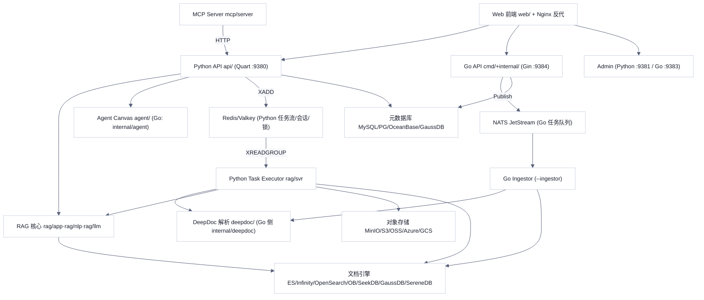
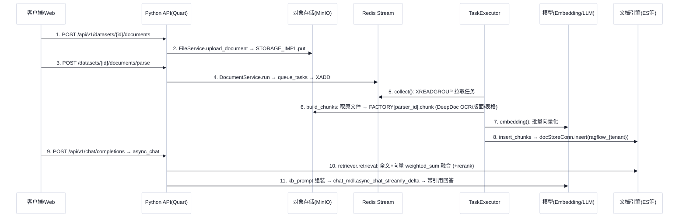

# RAGFlow 技术架构分析（v0.27.2）

> 分析对象：infiniflow/ragflow，tag `v0.27.2`，commit `a024bea0cd93f39e6652a42bf84dd20c55bc560b`
> 标记说明：✅ 代码事实（有出处）；🔍 推断；❓ 未确认。行号全部来自本次 `grep -n` / `cat -n` 的实际输出。
> 安全说明：仓库内存在多处默认口令（如 `docker/.env` L52、L144、L182、L190、L247，`helm/values.yaml` L27、L34），本文不抄录具体值，生产部署必须修改。

---

## 1. 模块划分与分层

### 1.1 模块依赖图

### 1.2 Python 与 Go 两套后端

| 维度 | Python 后端（默认） | Go 后端（迁移中） |
|---|---|---|
| 入口 | `api/ragflow_server.py`，Quart 应用 `app.run(...)` ✅ [api/ragflow_server.py:L173](https://github.com/infiniflow/ragflow/blob/a024bea0cd93f39e6652a42bf84dd20c55bc560b/api/ragflow_server.py#L173)；Quart 实例 ✅ [api/apps/__init__.py:L61-L62](https://github.com/infiniflow/ragflow/blob/a024bea0cd93f39e6652a42bf84dd20c55bc560b/api/apps/__init__.py#L61-L62) | 单二进制 `bin/ragflow_server`，按 `--admin/--api/--ingestor/--syncer` 分模式运行 ✅ [cmd/ragflow_server.go:L69-L104](https://github.com/infiniflow/ragflow/blob/a024bea0cd93f39e6652a42bf84dd20c55bc560b/cmd/ragflow_server.go#L69-L104) |
| 路由注册 | 自动扫描 `*_app.py`、`sdk/*.py`、`restful_apis/*.py` 注册 Blueprint ✅ [api/apps/__init__.py:L340-L376](https://github.com/infiniflow/ragflow/blob/a024bea0cd93f39e6652a42bf84dd20c55bc560b/api/apps/__init__.py#L340-L376) | Gin Router ✅ `internal/router/router.go` |
| 解析/切片 | `rag/svr/task_executor.py` 消费 Redis Stream ✅ [rag/svr/task_executor.py:L247-L263](https://github.com/infiniflow/ragflow/blob/a024bea0cd93f39e6652a42bf84dd20c55bc560b/rag/svr/task_executor.py#L247-L263) | Ingestor 消费 NATS ✅ [cmd/ragflow_server.go:L551-L607](https://github.com/infiniflow/ragflow/blob/a024bea0cd93f39e6652a42bf84dd20c55bc560b/cmd/ragflow_server.go#L551-L607)；进程内 DeepDoc（ONNX Runtime，需 cgo）✅ [cmd/ragflow_server.go:L1094-L1115](https://github.com/infiniflow/ragflow/blob/a024bea0cd93f39e6652a42bf84dd20c55bc560b/cmd/ragflow_server.go#L1094-L1115) |
| 元数据库 | MySQL / OceanBase / PostgreSQL / GaussDB ✅ [api/db/db_models.py:L797-L803](https://github.com/infiniflow/ragflow/blob/a024bea0cd93f39e6652a42bf84dd20c55bc560b/api/db/db_models.py#L797-L803) | **仅 MySQL**（gorm mysql driver）✅ [internal/dao/database.go:L69-L92](https://github.com/infiniflow/ragflow/blob/a024bea0cd93f39e6652a42bf84dd20c55bc560b/internal/dao/database.go#L69-L92) |
| 文档引擎 | ES/Infinity/OpenSearch/OceanBase/SeekDB/GaussDB/SereneDB ✅ [common/settings.py:L398-L424](https://github.com/infiniflow/ragflow/blob/a024bea0cd93f39e6652a42bf84dd20c55bc560b/common/settings.py#L398-L424) | ES/Infinity/OceanBase/SeekDB/SereneDB，**无 OpenSearch、GaussDB** ✅ [internal/engine/global.go:L52-L68](https://github.com/infiniflow/ragflow/blob/a024bea0cd93f39e6652a42bf84dd20c55bc560b/internal/engine/global.go#L52-L68) |
| 消息队列 | Redis Stream（未找到 Python 使用 NATS 的代码） | 仅 NATS ✅ [internal/engine/global.go:L108-L127](https://github.com/infiniflow/ragflow/blob/a024bea0cd93f39e6652a42bf84dd20c55bc560b/internal/engine/global.go#L108-L127) |

**默认用哪套**：`docker/.env` 默认 `API_PROXY_SCHEME=python` ✅ [docker/.env:L249-L251](https://github.com/infiniflow/ragflow/blob/a024bea0cd93f39e6652a42bf84dd20c55bc560b/docker/.env#L249-L251)；entrypoint 在未设置时也回退到 python 版 nginx 配置 ✅ [docker/entrypoint.sh:L201-L217](https://github.com/infiniflow/ragflow/blob/a024bea0cd93f39e6652a42bf84dd20c55bc560b/docker/entrypoint.sh#L201-L217)。三种模式按开关分别启动 Python/Go 的 Admin、API、任务执行器 ✅ [docker/entrypoint.sh:L299-L370](https://github.com/infiniflow/ragflow/blob/a024bea0cd93f39e6652a42bf84dd20c55bc560b/docker/entrypoint.sh#L299-L370)。

**迁移进度迹象**：
- ✅ hybrid 模式下 nginx 仅把 `/api/v1/skills`、`/api/v1/chat/completions`、`/v1/system/config`、登录登出、部分 admin 路由交给 Go（9383/9384），其余 `/(v1|api)` 仍走 Python 9380 [docker/nginx/ragflow.conf.hybrid:L13-L66](https://github.com/infiniflow/ragflow/blob/a024bea0cd93f39e6652a42bf84dd20c55bc560b/docker/nginx/ragflow.conf.hybrid#L13-L66)；go 模式则全部转 Go [docker/nginx/ragflow.conf.golang:L13-L26](https://github.com/infiniflow/ragflow/blob/a024bea0cd93f39e6652a42bf84dd20c55bc560b/docker/nginx/ragflow.conf.golang#L13-L26)。
- ✅ **Go 有、Python 无**：Skill Space 检索只在 Go 实现，Python 通过 HTTP 调 Go 的 9384 端口 [api/apps/services/file_api_service.py:L237-L248](https://github.com/infiniflow/ragflow/blob/a024bea0cd93f39e6652a42bf84dd20c55bc560b/api/apps/services/file_api_service.py#L237-L248)、[internal/router/router.go:L527-L535](https://github.com/infiniflow/ragflow/blob/a024bea0cd93f39e6652a42bf84dd20c55bc560b/internal/router/router.go#L527-L535)；NATS JetStream 也只有 Go 使用。
- ✅ **Python 有、Go 无**：PostgreSQL/OceanBase/GaussDB 元数据库、OpenSearch/GaussDB 文档引擎、MCP Server（`mcp/server/server.py`）、默认 entrypoint 中的数据源同步（`rag/svr/sync_data_source.py`）[docker/entrypoint.sh:L329-L332](https://github.com/infiniflow/ragflow/blob/a024bea0cd93f39e6652a42bf84dd20c55bc560b/docker/entrypoint.sh#L329-L332)。Go 的 syncer 只在 `entrypoint-go.sh` 中启动 ✅ [docker/entrypoint-go.sh:L298](https://github.com/infiniflow/ragflow/blob/a024bea0cd93f39e6652a42bf84dd20c55bc560b/docker/entrypoint-go.sh#L298)。
- 🔍 规模：本次统计 `internal/`+`cmd/` 共 731,812 行 Go，其中 `_test.go` 309,611 行；Python 主目录约 234,531 行。Go 路由注册约 345 处、Python `@manager.route` 约 297 处（`grep -c` 粗算），Go 路由面已不小于 Python。Go 解析器目录有大量 `*_parity_test.go`（与 Python 输出对齐的测试），说明是"按 Python 行为逐项复刻"式迁移。
- ✅ Go 侧"进程内 DeepDoc 是唯一生产后端，缺 ORT/模型即 Fatal" [cmd/ragflow_server.go:L1103-L1112](https://github.com/infiniflow/ragflow/blob/a024bea0cd93f39e6652a42bf84dd20c55bc560b/cmd/ragflow_server.go#L1103-L1112)。
- 🔍 选型结论：v0.27.2 生产推荐仍是 Python 后端；Go 后端已覆盖大部分 API，但数据库与引擎兼容面更窄，且 NATS profile `ragflow-go` 未出现在默认 `COMPOSE_PROFILES` 中（仅在 [docker/docker-compose-base.yml:L302-L305](https://github.com/infiniflow/ragflow/blob/a024bea0cd93f39e6652a42bf84dd20c55bc560b/docker/docker-compose-base.yml#L302-L305) 出现），需要手动启用。

---

## 2. 核心抽象

| 抽象 | 说明 | 出处 |
|---|---|---|
| `DocStoreConnection`（Python） | 文档引擎抽象基类：`create_idx / search / insert / update / delete / get_fields / sql`，检索表达式 `MatchTextExpr / MatchDenseExpr / FusionExpr` | ✅ [common/doc_store/doc_store_base.py:L58-L148](https://github.com/infiniflow/ragflow/blob/a024bea0cd93f39e6652a42bf84dd20c55bc560b/common/doc_store/doc_store_base.py#L58-L148)、[L148-L273](https://github.com/infiniflow/ragflow/blob/a024bea0cd93f39e6652a42bf84dd20c55bc560b/common/doc_store/doc_store_base.py#L148-L273) |
| 引擎实现 | `ESConnection`、`InfinityConnection`、`OSConnection`、`OBConnection`、`GaussDBConnection`、`SereneDBConnection` | ✅ [rag/utils/es_conn.py:L101](https://github.com/infiniflow/ragflow/blob/a024bea0cd93f39e6652a42bf84dd20c55bc560b/rag/utils/es_conn.py#L101)、[rag/utils/opensearch_conn.py:L65](https://github.com/infiniflow/ragflow/blob/a024bea0cd93f39e6652a42bf84dd20c55bc560b/rag/utils/opensearch_conn.py#L65)、[rag/utils/serenedb_conn.py:L194](https://github.com/infiniflow/ragflow/blob/a024bea0cd93f39e6652a42bf84dd20c55bc560b/rag/utils/serenedb_conn.py#L194) |
| `DocEngine` / `MessageQueue`（Go） | Go 侧对应接口：Chunk/Metadata 存储、Search、KNNScores；队列 `PublishTask/PullMessages` | ✅ [internal/engine/engine.go:L41-L81](https://github.com/infiniflow/ragflow/blob/a024bea0cd93f39e6652a42bf84dd20c55bc560b/internal/engine/engine.go#L41-L81)、[L111-L126](https://github.com/infiniflow/ragflow/blob/a024bea0cd93f39e6652a42bf84dd20c55bc560b/internal/engine/engine.go#L111-L126) |
| chunk 模板 `parser_id` | `ParserType` 枚举 15 种（naive/paper/book/presentation/manual/laws/qa/table/resume/picture/one/audio/email/knowledge_graph/tag） | ✅ [common/constants.py:L123-L138](https://github.com/infiniflow/ragflow/blob/a024bea0cd93f39e6652a42bf84dd20c55bc560b/common/constants.py#L123-L138) |
| 切片器工厂 `FACTORY` | `parser_id → rag/app/*.py` 模块，每个模块提供 `chunk()` | ✅ [rag/svr/task_executor.py:L112-L129](https://github.com/infiniflow/ragflow/blob/a024bea0cd93f39e6652a42bf84dd20c55bc560b/rag/svr/task_executor.py#L112-L129)、[L339](https://github.com/infiniflow/ragflow/blob/a024bea0cd93f39e6652a42bf84dd20c55bc560b/rag/svr/task_executor.py#L339) |
| PDF 解析后端 `PARSERS` | naive 模板下可选 deepdoc / mineru / docling / opendataloader / tcadp / paddleocr / plaintext 等 | ✅ [rag/app/naive.py:L550-L560](https://github.com/infiniflow/ragflow/blob/a024bea0cd93f39e6652a42bf84dd20c55bc560b/rag/app/naive.py#L550-L560) |
| DeepDoc `RAGFlowPdfParser` | 组合 OCR、LayoutRecognizer（含 Ascend 版）、TableStructureRecognizer、XGBoost 上下文拼接模型 | ✅ [deepdoc/parser/pdf_parser.py:L56-L101](https://github.com/infiniflow/ragflow/blob/a024bea0cd93f39e6652a42bf84dd20c55bc560b/deepdoc/parser/pdf_parser.py#L56-L101) |
| 检索器 `Dealer` | 全文 + 向量混合检索（`FusionExpr("weighted_sum")`）、rerank、引用插入、TOC/父子块检索 | ✅ [rag/nlp/search.py:L50-L60](https://github.com/infiniflow/ragflow/blob/a024bea0cd93f39e6652a42bf84dd20c55bc560b/rag/nlp/search.py#L50-L60)、[L178](https://github.com/infiniflow/ragflow/blob/a024bea0cd93f39e6652a42bf84dd20c55bc560b/rag/nlp/search.py#L178)、[L593](https://github.com/infiniflow/ragflow/blob/a024bea0cd93f39e6652a42bf84dd20c55bc560b/rag/nlp/search.py#L593)；全局实例化 [common/settings.py:L475-L479](https://github.com/infiniflow/ragflow/blob/a024bea0cd93f39e6652a42bf84dd20c55bc560b/common/settings.py#L475-L479) |
| LLM 模型抽象 | 7 类模型基类（chat/embedding/rerank/cv/seq2txt/tts/ocr），类属性 `_FACTORY_NAME` 反射注册到 `MODULE_MAPPING` | ✅ [rag/llm/__init__.py:L145-L195](https://github.com/infiniflow/ragflow/blob/a024bea0cd93f39e6652a42bf84dd20c55bc560b/rag/llm/__init__.py#L145-L195)、[rag/llm/chat_model.py:L316](https://github.com/infiniflow/ragflow/blob/a024bea0cd93f39e6652a42bf84dd20c55bc560b/rag/llm/chat_model.py#L316)、[rag/llm/embedding_model.py:L148](https://github.com/infiniflow/ragflow/blob/a024bea0cd93f39e6652a42bf84dd20c55bc560b/rag/llm/embedding_model.py#L148) |
| 租户模型绑定 `LLMBundle` | 按租户配置实例化具体工厂类 | ✅ [api/db/services/llm_service.py:L79](https://github.com/infiniflow/ragflow/blob/a024bea0cd93f39e6652a42bf84dd20c55bc560b/api/db/services/llm_service.py#L79)、[api/db/services/tenant_llm_service.py:L193](https://github.com/infiniflow/ragflow/blob/a024bea0cd93f39e6652a42bf84dd20c55bc560b/api/db/services/tenant_llm_service.py#L193)、[L211](https://github.com/infiniflow/ragflow/blob/a024bea0cd93f39e6652a42bf84dd20c55bc560b/api/db/services/tenant_llm_service.py#L211) |
| Agent Canvas | DSL（components + upstream/downstream）→ `Graph` / `Canvas`；组件基类 `ComponentBase.invoke/_invoke/output` | ✅ [agent/canvas.py:L49-L70](https://github.com/infiniflow/ragflow/blob/a024bea0cd93f39e6652a42bf84dd20c55bc560b/agent/canvas.py#L49-L70)、[L331](https://github.com/infiniflow/ragflow/blob/a024bea0cd93f39e6652a42bf84dd20c55bc560b/agent/canvas.py#L331)、[agent/component/base.py:L369-L506](https://github.com/infiniflow/ragflow/blob/a024bea0cd93f39e6652a42bf84dd20c55bc560b/agent/component/base.py#L369-L506) |
| 摄入流水线 | `Pipeline(Graph)` 复用 Canvas 图引擎，组件基类 `ProcessBase` | ✅ [rag/flow/pipeline.py:L28](https://github.com/infiniflow/ragflow/blob/a024bea0cd93f39e6652a42bf84dd20c55bc560b/rag/flow/pipeline.py#L28)、[rag/flow/base.py:L33](https://github.com/infiniflow/ragflow/blob/a024bea0cd93f39e6652a42bf84dd20c55bc560b/rag/flow/base.py#L33) |
| 对象存储 `StorageFactory` | MinIO / Azure SPN / Azure SAS / S3 / OSS / OpenDAL / GCS，可叠加加密存储 | ✅ [common/settings.py:L291-L304](https://github.com/infiniflow/ragflow/blob/a024bea0cd93f39e6652a42bf84dd20c55bc560b/common/settings.py#L291-L304)、[L454-L473](https://github.com/infiniflow/ragflow/blob/a024bea0cd93f39e6652a42bf84dd20c55bc560b/common/settings.py#L454-L473) |

---

## 3. 模块间通信

| 通道 | 说明 | 出处 |
|---|---|---|
| HTTP（外部） | Nginx 静态托管 `web/dist`，`/(v1|api)` 反代到 9380（Python）或 9384（Go），`/api/v1/admin` 到 9381/9383 | ✅ [docker/nginx/ragflow.conf.python:L13-L21](https://github.com/infiniflow/ragflow/blob/a024bea0cd93f39e6652a42bf84dd20c55bc560b/docker/nginx/ragflow.conf.python#L13-L21) |
| HTTP（内部 Python→Go） | Python 通过 `HOST_PORT+4`（9384）调用 Go 的 skills 接口 | ✅ [api/apps/services/file_api_service.py:L242-L248](https://github.com/infiniflow/ragflow/blob/a024bea0cd93f39e6652a42bf84dd20c55bc560b/api/apps/services/file_api_service.py#L242-L248) |
| HTTP（MCP→API） | MCP Server 默认 `BASE_URL=http://127.0.0.1:9380`，`ragflow_retrieval` 工具转发到 `/retrieval` | ✅ [mcp/server/server.py:L48](https://github.com/infiniflow/ragflow/blob/a024bea0cd93f39e6652a42bf84dd20c55bc560b/mcp/server/server.py#L48)、[L310](https://github.com/infiniflow/ragflow/blob/a024bea0cd93f39e6652a42bf84dd20c55bc560b/mcp/server/server.py#L310)、[L554](https://github.com/infiniflow/ragflow/blob/a024bea0cd93f39e6652a42bf84dd20c55bc560b/mcp/server/server.py#L554) |
| Redis Stream（Python 任务分发） | 生产：`queue_product` → `XADD`；消费：`queue_consumer` → `XREADGROUP`（消费组），支持未 ACK 消息重放；队列名按优先级 1/0 和类型后缀 | ✅ [rag/utils/redis_conn.py:L404-L408](https://github.com/infiniflow/ragflow/blob/a024bea0cd93f39e6652a42bf84dd20c55bc560b/rag/utils/redis_conn.py#L404-L408)、[L415-L439](https://github.com/infiniflow/ragflow/blob/a024bea0cd93f39e6652a42bf84dd20c55bc560b/rag/utils/redis_conn.py#L415-L439)、[L456](https://github.com/infiniflow/ragflow/blob/a024bea0cd93f39e6652a42bf84dd20c55bc560b/rag/utils/redis_conn.py#L456)；[common/settings.py:L225-L248](https://github.com/infiniflow/ragflow/blob/a024bea0cd93f39e6652a42bf84dd20c55bc560b/common/settings.py#L225-L248) |
| Redis 其他用途 | Quart Session 存 Redis；分布式锁 `RedisDistributedLock`；SECRET_KEY 存储 | ✅ [api/apps/__init__.py:L78-L80](https://github.com/infiniflow/ragflow/blob/a024bea0cd93f39e6652a42bf84dd20c55bc560b/api/apps/__init__.py#L78-L80)、[api/ragflow_server.py:L48](https://github.com/infiniflow/ragflow/blob/a024bea0cd93f39e6652a42bf84dd20c55bc560b/api/ragflow_server.py#L48)、[common/settings.py:L285](https://github.com/infiniflow/ragflow/blob/a024bea0cd93f39e6652a42bf84dd20c55bc560b/common/settings.py#L285) |
| NATS JetStream（Go） | Go API/Admin/记忆服务向 subject `tasks.RAGFLOW` 发布，Ingestor 消费；另有知识编译流、syncer 流与 KV | ✅ [internal/engine/nats/nats.go:L31-L49](https://github.com/infiniflow/ragflow/blob/a024bea0cd93f39e6652a42bf84dd20c55bc560b/internal/engine/nats/nats.go#L31-L49)、[L106](https://github.com/infiniflow/ragflow/blob/a024bea0cd93f39e6652a42bf84dd20c55bc560b/internal/engine/nats/nats.go#L106)；[internal/common/task.go:L26](https://github.com/infiniflow/ragflow/blob/a024bea0cd93f39e6652a42bf84dd20c55bc560b/internal/common/task.go#L26)；[internal/service/task_publisher.go:L21-L30](https://github.com/infiniflow/ragflow/blob/a024bea0cd93f39e6652a42bf84dd20c55bc560b/internal/service/task_publisher.go#L21-L30) |
| 心跳 | Go 的 api/ingestor/syncer 向 Admin 上报心跳 | ✅ [cmd/ragflow_server.go:L619-L627](https://github.com/infiniflow/ragflow/blob/a024bea0cd93f39e6652a42bf84dd20c55bc560b/cmd/ragflow_server.go#L619-L627) |

🔍 hybrid 模式下 Python 与 Go 各自往 Redis / NATS 发任务，两套执行器各消费各的队列；未找到两条队列互通的代码（❓ 需实测）。

---

## 4. 配置与存储

### 4.1 配置加载链

1. `docker/.env` → compose 环境变量（`DOC_ENGINE`、`DB_TYPE`、`DEVICE`、`COMPOSE_PROFILES` 等）✅ [docker/.env:L15-L38](https://github.com/infiniflow/ragflow/blob/a024bea0cd93f39e6652a42bf84dd20c55bc560b/docker/.env#L15-L38)
2. 容器启动时 entrypoint 把 `conf/service_conf.yaml.template` 中的 `${VAR:-default}` 替换成 `conf/service_conf.yaml` ✅ [docker/entrypoint.sh:L174-L193](https://github.com/infiniflow/ragflow/blob/a024bea0cd93f39e6652a42bf84dd20c55bc560b/docker/entrypoint.sh#L174-L193)；模板由 Dockerfile 拷入 ✅ [Dockerfile:L261](https://github.com/infiniflow/ragflow/blob/a024bea0cd93f39e6652a42bf84dd20c55bc560b/Dockerfile#L261)。模板分段：ragflow/admin/mysql/minio/es/os/infinity/serenedb/oceanbase/gaussdb/seekdb/redis/nats/clickhouse/otel/ingestor/user_default_llm ✅ [docker/service_conf.yaml.template:L1-L104](https://github.com/infiniflow/ragflow/blob/a024bea0cd93f39e6652a42bf84dd20c55bc560b/docker/service_conf.yaml.template#L1-L104)
3. Python：`read_config` 读 `service_conf.yaml`，再用 `local.service_conf.yaml` 覆盖 ✅ [common/config_utils.py:L55-L75](https://github.com/infiniflow/ragflow/blob/a024bea0cd93f39e6652a42bf84dd20c55bc560b/common/config_utils.py#L55-L75)；引擎/DB/存储类型仍以环境变量为准 ✅ [common/settings.py:L157-L173](https://github.com/infiniflow/ragflow/blob/a024bea0cd93f39e6652a42bf84dd20c55bc560b/common/settings.py#L157-L173)、[L221](https://github.com/infiniflow/ragflow/blob/a024bea0cd93f39e6652a42bf84dd20c55bc560b/common/settings.py#L221)
4. Go：viper 读 `./conf`、`.`、`/etc/ragflow/` 下的 `service_conf`，并支持 `RAGFLOW_` 前缀环境变量 ✅ [internal/server/config.go:L40-L68](https://github.com/infiniflow/ragflow/blob/a024bea0cd93f39e6652a42bf84dd20c55bc560b/internal/server/config.go#L40-L68)
5. Helm：`service_conf` 写到 `local.service_conf.yaml` ✅ [helm/values.yaml:L83-L87](https://github.com/infiniflow/ragflow/blob/a024bea0cd93f39e6652a42bf84dd20c55bc560b/helm/values.yaml#L83-L87)

### 4.2 各存储存什么

| 存储 | 内容 | 出处 |
|---|---|---|
| 元数据库 | User/Tenant/TenantLLM/Knowledgebase/Document/File/Task/Dialog/UserCanvas/Search/Connector/Memory 等业务表（peewee ORM） | ✅ [api/db/db_models.py:L1095](https://github.com/infiniflow/ragflow/blob/a024bea0cd93f39e6652a42bf84dd20c55bc560b/api/db/db_models.py#L1095)、[L1259](https://github.com/infiniflow/ragflow/blob/a024bea0cd93f39e6652a42bf84dd20c55bc560b/api/db/db_models.py#L1259)、[L1318](https://github.com/infiniflow/ragflow/blob/a024bea0cd93f39e6652a42bf84dd20c55bc560b/api/db/db_models.py#L1318)、[L1428](https://github.com/infiniflow/ragflow/blob/a024bea0cd93f39e6652a42bf84dd20c55bc560b/api/db/db_models.py#L1428)、[L1538](https://github.com/infiniflow/ragflow/blob/a024bea0cd93f39e6652a42bf84dd20c55bc560b/api/db/db_models.py#L1538)、[L1810](https://github.com/infiniflow/ragflow/blob/a024bea0cd93f39e6652a42bf84dd20c55bc560b/api/db/db_models.py#L1810) |
| 对象存储 | 原始文件（bucket=kb_id）、缩略图、切片中的图片 | ✅ [api/db/services/file_service.py:L623-L654](https://github.com/infiniflow/ragflow/blob/a024bea0cd93f39e6652a42bf84dd20c55bc560b/api/db/services/file_service.py#L623-L654)、[rag/svr/task_executor.py:L451](https://github.com/infiniflow/ragflow/blob/a024bea0cd93f39e6652a42bf84dd20c55bc560b/rag/svr/task_executor.py#L451) |
| 文档引擎 | 切片全文 + 向量（字段 `q_<dim>_vec`），按租户一个索引 `ragflow_<tenant_id>` | ✅ [rag/nlp/search.py:L46-L47](https://github.com/infiniflow/ragflow/blob/a024bea0cd93f39e6652a42bf84dd20c55bc560b/rag/nlp/search.py#L46-L47)、[rag/svr/task_executor.py:L792](https://github.com/infiniflow/ragflow/blob/a024bea0cd93f39e6652a42bf84dd20c55bc560b/rag/svr/task_executor.py#L792) |
| 文档引擎（记忆） | Memory 消息复用同一引擎，但只实现 ES/Infinity/OceanBase+SeekDB/GaussDB，🔍 OpenSearch、SereneDB 下记忆功能可能不可用 | ✅ [common/settings.py:L426-L440](https://github.com/infiniflow/ragflow/blob/a024bea0cd93f39e6652a42bf84dd20c55bc560b/common/settings.py#L426-L440) |
| Redis | 任务流、会话、锁、LLM 缓存 | 见第 3 节 |

### 4.3 可替换实现（以代码为准）

- **元数据库**：Python 支持 MySQL、OceanBase、PostgreSQL、GaussDB ✅ [api/db/db_models.py:L797-L820](https://github.com/infiniflow/ragflow/blob/a024bea0cd93f39e6652a42bf84dd20c55bc560b/api/db/db_models.py#L797-L820)；`.env` 注释同样列出 mysql/postgres/gaussdb/oceanbase ✅ [docker/.env:L23-L25](https://github.com/infiniflow/ragflow/blob/a024bea0cd93f39e6652a42bf84dd20c55bc560b/docker/.env#L23-L25)。**达梦 / 人大金仓：全仓库 grep `dameng|dm8|达梦|kingbase` 未找到**。Go 后端只支持 MySQL。另外"模型供应商表迁移"脚本只适用于 MySQL，遇到 GaussDB 会跳过 ✅ [docker/entrypoint.sh:L287-L297](https://github.com/infiniflow/ragflow/blob/a024bea0cd93f39e6652a42bf84dd20c55bc560b/docker/entrypoint.sh#L287-L297)。
- **文档引擎**：见 1.2 表格；GaussDB 文档引擎在 compose 中没有对应服务，只能连外部实例（`.env` 中 GAUSSDB_HOST 默认留空）✅ [docker/.env:L107](https://github.com/infiniflow/ragflow/blob/a024bea0cd93f39e6652a42bf84dd20c55bc560b/docker/.env#L107)。
- **对象存储**：Python 支持 MinIO/S3/OSS/Azure/GCS/OpenDAL（见第 2 节）；Go 侧有 minio/s3/oss/gcs/memory 实现（`internal/storage/` 目录列表）✅。
- **Redis**：compose 默认使用 Valkey 8 ✅ [docker/docker-compose-base.yml:L269-L272](https://github.com/infiniflow/ragflow/blob/a024bea0cd93f39e6652a42bf84dd20c55bc560b/docker/docker-compose-base.yml#L269-L272)。

---

## 5. 部署形态

### 5.1 docker-compose 服务与 profiles

`docker-compose.yml` include `docker-compose-base.yml` ✅ [docker/docker-compose.yml:L1-L15](https://github.com/infiniflow/ragflow/blob/a024bea0cd93f39e6652a42bf84dd20c55bc560b/docker/docker-compose.yml#L1-L15)。

| 服务 | profile | 出处 |
|---|---|---|
| es01 / opensearch01 / infinity / serenedb / oceanbase / seekdb | 与 `DOC_ENGINE` 同名 | ✅ [docker/docker-compose-base.yml:L2-L158](https://github.com/infiniflow/ragflow/blob/a024bea0cd93f39e6652a42bf84dd20c55bc560b/docker/docker-compose-base.yml#L2-L158) |
| mysql | `mysql` / `metadata-mysql` | ✅ [L215-L222](https://github.com/infiniflow/ragflow/blob/a024bea0cd93f39e6652a42bf84dd20c55bc560b/docker/docker-compose-base.yml#L215-L222) |
| minio（镜像为 MinIO 兼容的 `pgsty/silo`）、redis（valkey） | **无 profile，总是启动** | ✅ [L248-L249](https://github.com/infiniflow/ragflow/blob/a024bea0cd93f39e6652a42bf84dd20c55bc560b/docker/docker-compose-base.yml#L248-L249)、[L269-L271](https://github.com/infiniflow/ragflow/blob/a024bea0cd93f39e6652a42bf84dd20c55bc560b/docker/docker-compose-base.yml#L269-L271) |
| sandbox-executor-manager | `sandbox` | ✅ [L179-L182](https://github.com/infiniflow/ragflow/blob/a024bea0cd93f39e6652a42bf84dd20c55bc560b/docker/docker-compose-base.yml#L179-L182) |
| jaeger / nats / tei-cpu / tei-gpu / kibana / clickhouse | `jaeger` / `ragflow-go` / `tei-cpu` / `tei-gpu` / `kibana` / `clickhouse` | ✅ [L287-L382](https://github.com/infiniflow/ragflow/blob/a024bea0cd93f39e6652a42bf84dd20c55bc560b/docker/docker-compose-base.yml#L287-L382) |
| ragflow-cpu / ragflow-gpu | `cpu` / `gpu` | ✅ [docker/docker-compose.yml:L5-L15](https://github.com/infiniflow/ragflow/blob/a024bea0cd93f39e6652a42bf84dd20c55bc560b/docker/docker-compose.yml#L5-L15)、[L71-L81](https://github.com/infiniflow/ragflow/blob/a024bea0cd93f39e6652a42bf84dd20c55bc560b/docker/docker-compose.yml#L71-L81) |
| deepdoc（仅 Go compose，Dockerfile_deepdoc_oss） | `deepdoc` | ✅ [docker/docker-compose-go.yml:L5-L19](https://github.com/infiniflow/ragflow/blob/a024bea0cd93f39e6652a42bf84dd20c55bc560b/docker/docker-compose-go.yml#L5-L19) |

**最少容器**：默认 `COMPOSE_PROFILES=${DOC_ENGINE},${DEVICE},metadata-${METADATA_DB_PROFILE}`，即 `elasticsearch,cpu,metadata-mysql` ✅ [docker/.env:L38](https://github.com/infiniflow/ragflow/blob/a024bea0cd93f39e6652a42bf84dd20c55bc560b/docker/.env#L38)。🔍 因此最少 5 个容器：ragflow-cpu + es01 + mysql + minio + redis。单个 ragflow 容器内部还会跑 nginx、API、Admin、task executor 和 data sync 多个进程 ✅ [docker/entrypoint.sh:L47-L51](https://github.com/infiniflow/ragflow/blob/a024bea0cd93f39e6652a42bf84dd20c55bc560b/docker/entrypoint.sh#L47-L51)。任务执行器可以通过 `--workers` / `--consumer-no-beg/end` 横向扩展 ✅ [docker/entrypoint.sh:L339-L369](https://github.com/infiniflow/ragflow/blob/a024bea0cd93f39e6652a42bf84dd20c55bc560b/docker/entrypoint.sh#L339-L369)。

### 5.2 Helm / K8s

- ✅ 有 Helm chart（`version: 0.1.1`，`appVersion: "dev"`）[helm/Chart.yaml:L1-L24](https://github.com/infiniflow/ragflow/blob/a024bea0cd93f39e6652a42bf84dd20c55bc560b/helm/Chart.yaml#L1-L24)；模板覆盖 ragflow、mysql、minio、redis、elasticsearch/opensearch/infinity、ingress（`helm/templates/` 列表）。
- ✅ Helm 默认 `DOC_ENGINE: infinity`，注释只列出 ES/Infinity/OpenSearch [helm/values.yaml:L13-L21](https://github.com/infiniflow/ragflow/blob/a024bea0cd93f39e6652a42bf84dd20c55bc560b/helm/values.yaml#L13-L21)；镜像 `infiniflow/ragflow:v0.27.2` [L77-L81](https://github.com/infiniflow/ragflow/blob/a024bea0cd93f39e6652a42bf84dd20c55bc560b/helm/values.yaml#L77-L81)。
- 🔍 Helm 中 grep `nats|API_PROXY|oceanbase|tei` 未找到，说明 chart 只支持 Python 后端 + 三种引擎，不含 Go/NATS、OceanBase、TEI；chart 版本号 0.1.x，可以用于 K8s，但成熟度一般。

### 5.3 ARM64 / GPU

- ✅ 发布流水线用普通 `docker build`，没有 `--platform` / buildx 多架构参数 [.github/workflows/release.yml:L288-L294](https://github.com/infiniflow/ragflow/blob/a024bea0cd93f39e6652a42bf84dd20c55bc560b/.github/workflows/release.yml#L288-L294)；`platforms` 在 workflows 中未找到，arm64 只出现在 Go CLI 的交叉编译矩阵 [L94-L111](https://github.com/infiniflow/ragflow/blob/a024bea0cd93f39e6652a42bf84dd20c55bc560b/.github/workflows/release.yml#L94-L111)。
- ✅ 文档明确说明不维护 ARM 镜像，需要自行构建 [docs/faq.mdx:L93](https://github.com/infiniflow/ragflow/blob/a024bea0cd93f39e6652a42bf84dd20c55bc560b/docs/faq.mdx#L93)；Dockerfile 中有 aarch64 分支，可以自建 [Dockerfile:L90](https://github.com/infiniflow/ragflow/blob/a024bea0cd93f39e6652a42bf84dd20c55bc560b/Dockerfile#L90)、[L160-L161](https://github.com/infiniflow/ragflow/blob/a024bea0cd93f39e6652a42bf84dd20c55bc560b/Dockerfile#L160-L161)。
- ✅ x86 绑定的迹象：entrypoint 写死 `LD_LIBRARY_PATH=/usr/lib/x86_64-linux-gnu/` [docker/entrypoint.sh:L195](https://github.com/infiniflow/ragflow/blob/a024bea0cd93f39e6652a42bf84dd20c55bc560b/docker/entrypoint.sh#L195)；Infinity 镜像 tag 为 `-x64-` [docker/docker-compose-base.yml:L79](https://github.com/infiniflow/ragflow/blob/a024bea0cd93f39e6652a42bf84dd20c55bc560b/docker/docker-compose-base.yml#L79)；Go 进程内 DeepDoc 依赖的 ORT 静态库只下载 linux-x64 版 [ragflow_deps/download_deps.py:L148-L151](https://github.com/infiniflow/ragflow/blob/a024bea0cd93f39e6652a42bf84dd20c55bc560b/ragflow_deps/download_deps.py#L148-L151)。🔍 在信创 ARM（鲲鹏/飞腾）上要自己构建，Go 后端和 Infinity 引擎在 ARM 上的可用性 ❓。
- ✅ **GPU 非必需**：默认 `DEVICE=cpu` [docker/.env:L27-L31](https://github.com/infiniflow/ragflow/blob/a024bea0cd93f39e6652a42bf84dd20c55bc560b/docker/.env#L27-L31)；`gpu` profile 通过 nvidia device reservation 申请 GPU [docker/docker-compose.yml:L133-L139](https://github.com/infiniflow/ragflow/blob/a024bea0cd93f39e6652a42bf84dd20c55bc560b/docker/docker-compose.yml#L133-L139)；DeepDoc 有 CUDA EP 分支 [deepdoc/vision/ocr.py:L114](https://github.com/infiniflow/ragflow/blob/a024bea0cd93f39e6652a42bf84dd20c55bc560b/deepdoc/vision/ocr.py#L114)。代码中还有昇腾版版面识别分支 [deepdoc/parser/pdf_parser.py:L85-L89](https://github.com/infiniflow/ragflow/blob/a024bea0cd93f39e6652a42bf84dd20c55bc560b/deepdoc/parser/pdf_parser.py#L85-L89)（启用条件 ❓）。

---

## 6. 核心链路时序：上传 → 解析切片 → 向量化 → 入库 → 检索问答（默认 Python 后端）

| 步 | 出处 |
|---|---|
| 1 | ✅ [api/apps/restful_apis/document_api.py:L441-L444](https://github.com/infiniflow/ragflow/blob/a024bea0cd93f39e6652a42bf84dd20c55bc560b/api/apps/restful_apis/document_api.py#L441-L444) |
| 2 | ✅ [api/db/services/file_service.py:L580](https://github.com/infiniflow/ragflow/blob/a024bea0cd93f39e6652a42bf84dd20c55bc560b/api/db/services/file_service.py#L580)、[L623](https://github.com/infiniflow/ragflow/blob/a024bea0cd93f39e6652a42bf84dd20c55bc560b/api/db/services/file_service.py#L623) |
| 3 | ✅ [api/apps/restful_apis/document_api.py:L1541-L1544](https://github.com/infiniflow/ragflow/blob/a024bea0cd93f39e6652a42bf84dd20c55bc560b/api/apps/restful_apis/document_api.py#L1541-L1544) |
| 4 | ✅ [api/db/services/document_service.py:L1226-L1246](https://github.com/infiniflow/ragflow/blob/a024bea0cd93f39e6652a42bf84dd20c55bc560b/api/db/services/document_service.py#L1226-L1246)（有 pipeline_id 时改走 `queue_dataflow`）；[api/db/services/task_service.py:L444](https://github.com/infiniflow/ragflow/blob/a024bea0cd93f39e6652a42bf84dd20c55bc560b/api/db/services/task_service.py#L444)、[L578](https://github.com/infiniflow/ragflow/blob/a024bea0cd93f39e6652a42bf84dd20c55bc560b/api/db/services/task_service.py#L578) |
| 5 | ✅ [rag/svr/task_executor.py:L247-L263](https://github.com/infiniflow/ragflow/blob/a024bea0cd93f39e6652a42bf84dd20c55bc560b/rag/svr/task_executor.py#L247-L263) |
| 6 | ✅ [rag/svr/task_executor.py:L331-L343](https://github.com/infiniflow/ragflow/blob/a024bea0cd93f39e6652a42bf84dd20c55bc560b/rag/svr/task_executor.py#L331-L343)；[rag/app/naive.py:L1069](https://github.com/infiniflow/ragflow/blob/a024bea0cd93f39e6652a42bf84dd20c55bc560b/rag/app/naive.py#L1069)；[deepdoc/parser/pdf_parser.py:L70-L90](https://github.com/infiniflow/ragflow/blob/a024bea0cd93f39e6652a42bf84dd20c55bc560b/deepdoc/parser/pdf_parser.py#L70-L90) |
| 7 | ✅ [rag/svr/task_executor.py:L744](https://github.com/infiniflow/ragflow/blob/a024bea0cd93f39e6652a42bf84dd20c55bc560b/rag/svr/task_executor.py#L744)、[L1644](https://github.com/infiniflow/ragflow/blob/a024bea0cd93f39e6652a42bf84dd20c55bc560b/rag/svr/task_executor.py#L1644) |
| 8 | ✅ [rag/svr/task_executor.py:L1323](https://github.com/infiniflow/ragflow/blob/a024bea0cd93f39e6652a42bf84dd20c55bc560b/rag/svr/task_executor.py#L1323)、[L1359-L1365](https://github.com/infiniflow/ragflow/blob/a024bea0cd93f39e6652a42bf84dd20c55bc560b/rag/svr/task_executor.py#L1359-L1365) |
| 9 | ✅ [api/apps/restful_apis/chat_api.py:L1240](https://github.com/infiniflow/ragflow/blob/a024bea0cd93f39e6652a42bf84dd20c55bc560b/api/apps/restful_apis/chat_api.py#L1240)；[api/db/services/conversation_service.py:L293](https://github.com/infiniflow/ragflow/blob/a024bea0cd93f39e6652a42bf84dd20c55bc560b/api/db/services/conversation_service.py#L293)；[api/db/services/dialog_service.py:L594](https://github.com/infiniflow/ragflow/blob/a024bea0cd93f39e6652a42bf84dd20c55bc560b/api/db/services/dialog_service.py#L594) |
| 10 | ✅ [api/db/services/dialog_service.py:L757-L769](https://github.com/infiniflow/ragflow/blob/a024bea0cd93f39e6652a42bf84dd20c55bc560b/api/db/services/dialog_service.py#L757-L769)；[rag/nlp/search.py:L242](https://github.com/infiniflow/ragflow/blob/a024bea0cd93f39e6652a42bf84dd20c55bc560b/rag/nlp/search.py#L242)、[L263](https://github.com/infiniflow/ragflow/blob/a024bea0cd93f39e6652a42bf84dd20c55bc560b/rag/nlp/search.py#L263)、[L268](https://github.com/infiniflow/ragflow/blob/a024bea0cd93f39e6652a42bf84dd20c55bc560b/rag/nlp/search.py#L268) |
| 11 | ✅ [api/db/services/dialog_service.py:L799](https://github.com/infiniflow/ragflow/blob/a024bea0cd93f39e6652a42bf84dd20c55bc560b/api/db/services/dialog_service.py#L799)、[L872](https://github.com/infiniflow/ragflow/blob/a024bea0cd93f39e6652a42bf84dd20c55bc560b/api/db/services/dialog_service.py#L872)、[L965](https://github.com/infiniflow/ragflow/blob/a024bea0cd93f39e6652a42bf84dd20c55bc560b/api/db/services/dialog_service.py#L965) |

---

## 7. 功能到模块映射

| 功能模块 | 主要代码位置 | 出处 |
|---|---|---|
| 知识库管理 | `api/apps/restful_apis/dataset_api.py`、`api/db/services/knowledgebase_service.py`；Go：`internal/handler/dataset.go` | ✅ [dataset_api.py:L36](https://github.com/infiniflow/ragflow/blob/a024bea0cd93f39e6652a42bf84dd20c55bc560b/api/apps/restful_apis/dataset_api.py#L36) |
| 文档解析 | `rag/svr/task_executor.py`、`rag/app/*`、`deepdoc/`、`rag/flow/`（Pipeline）；Go：`internal/ingestion`、`internal/deepdoc`、`internal/parser` | ✅ [task_executor.py:L112-L129](https://github.com/infiniflow/ragflow/blob/a024bea0cd93f39e6652a42bf84dd20c55bc560b/rag/svr/task_executor.py#L112-L129)、[naive.py:L550-L560](https://github.com/infiniflow/ragflow/blob/a024bea0cd93f39e6652a42bf84dd20c55bc560b/rag/app/naive.py#L550-L560) |
| 检索问答 | `api/db/services/dialog_service.py`、`rag/nlp/search.py`、`rag/graphrag/`、`chat_api.py`、`chunk_api.py`（/retrieval） | ✅ [dialog_service.py:L594](https://github.com/infiniflow/ragflow/blob/a024bea0cd93f39e6652a42bf84dd20c55bc560b/api/db/services/dialog_service.py#L594)、[chunk_api.py:L335](https://github.com/infiniflow/ragflow/blob/a024bea0cd93f39e6652a42bf84dd20c55bc560b/api/apps/restful_apis/chunk_api.py#L335) |
| Agent 工作流 | `agent/canvas.py`、`agent/component/`、`agent/tools/`、`agent/sandbox/`、`agent_api.py`；Go：`internal/agent/` | ✅ [canvas.py:L331](https://github.com/infiniflow/ragflow/blob/a024bea0cd93f39e6652a42bf84dd20c55bc560b/agent/canvas.py#L331)、[agent_api.py:L430](https://github.com/infiniflow/ragflow/blob/a024bea0cd93f39e6652a42bf84dd20c55bc560b/api/apps/restful_apis/agent_api.py#L430) |
| 搜索 | `search_api.py`、`api/db/db_models.py` 中的 `Search` 表；Go：`internal/handler/search.go`、`skill_search.go` | ✅ [search_api.py:L43](https://github.com/infiniflow/ragflow/blob/a024bea0cd93f39e6652a42bf84dd20c55bc560b/api/apps/restful_apis/search_api.py#L43)、[db_models.py:L1631](https://github.com/infiniflow/ragflow/blob/a024bea0cd93f39e6652a42bf84dd20c55bc560b/api/db/db_models.py#L1631) |
| 记忆 | `memory/`（services + 各引擎 conn）、`memory_api.py`、`api/db/joint_services/memory_message_service.py` | ✅ [memory_api.py:L30](https://github.com/infiniflow/ragflow/blob/a024bea0cd93f39e6652a42bf84dd20c55bc560b/api/apps/restful_apis/memory_api.py#L30)、[settings.py:L426-L440](https://github.com/infiniflow/ragflow/blob/a024bea0cd93f39e6652a42bf84dd20c55bc560b/common/settings.py#L426-L440) |
| 数据源同步 | `rag/svr/sync_data_source.py`（`SyncBase` 及其子类）、`common/data_source/*_connector.py`（约 40 种）、`connector_api.py`；Go：`internal/syncer` | ✅ [sync_data_source.py:L141](https://github.com/infiniflow/ragflow/blob/a024bea0cd93f39e6652a42bf84dd20c55bc560b/rag/svr/sync_data_source.py#L141)、[connector_api.py:L49](https://github.com/infiniflow/ragflow/blob/a024bea0cd93f39e6652a42bf84dd20c55bc560b/api/apps/restful_apis/connector_api.py#L49) |
| 模型管理 | `rag/llm/*`、`conf/llm_factories.json`、`models_api.py`、`provider_api.py`、`tenant_llm_service.py` | ✅ [rag/llm/__init__.py:L155-L164](https://github.com/infiniflow/ragflow/blob/a024bea0cd93f39e6652a42bf84dd20c55bc560b/rag/llm/__init__.py#L155-L164)、[models_api.py:L31](https://github.com/infiniflow/ragflow/blob/a024bea0cd93f39e6652a42bf84dd20c55bc560b/api/apps/restful_apis/models_api.py#L31)、[provider_api.py:L30](https://github.com/infiniflow/ragflow/blob/a024bea0cd93f39e6652a42bf84dd20c55bc560b/api/apps/restful_apis/provider_api.py#L30) |
| 系统管理 | `admin/server/`（Flask，:9381）、`system_api.py`、`tenant_api.py`、`user_api.py`；Go：`internal/admin` | ✅ [admin/server/admin_server.py:L27-L35](https://github.com/infiniflow/ragflow/blob/a024bea0cd93f39e6652a42bf84dd20c55bc560b/admin/server/admin_server.py#L27-L35)、[system_api.py:L39](https://github.com/infiniflow/ragflow/blob/a024bea0cd93f39e6652a42bf84dd20c55bc560b/api/apps/restful_apis/system_api.py#L39) |
| API & SDK & MCP | REST：`api/apps/restful_apis/`（前缀 `/api/v1`）；OpenAI 兼容 `openai_api.py`；Dify 外部知识库 `dify_retrieval_api.py`；Python SDK `sdk/python/ragflow_sdk`；MCP `mcp/server/server.py`；Go CLI `cmd/ragflow-cli.go` | ✅ [api/apps/__init__.py:L363](https://github.com/infiniflow/ragflow/blob/a024bea0cd93f39e6652a42bf84dd20c55bc560b/api/apps/__init__.py#L363)、[openai_api.py:L237](https://github.com/infiniflow/ragflow/blob/a024bea0cd93f39e6652a42bf84dd20c55bc560b/api/apps/restful_apis/openai_api.py#L237)、[dify_retrieval_api.py:L111](https://github.com/infiniflow/ragflow/blob/a024bea0cd93f39e6652a42bf84dd20c55bc560b/api/apps/restful_apis/dify_retrieval_api.py#L111)、[mcp/server/server.py:L554-L639](https://github.com/infiniflow/ragflow/blob/a024bea0cd93f39e6652a42bf84dd20c55bc560b/mcp/server/server.py#L554-L639) |

---

## 8. 离线部署相关技术事实

### 8.1 镜像内已内置的资源

- ✅ DeepDoc 的 OCR、版面、表格 ONNX 模型和 XGBoost 拼接模型，构建时从 `infiniflow/ragflow_deps` 镜像拷到 `/ragflow/rag/res/deepdoc` [Dockerfile:L15-L21](https://github.com/infiniflow/ragflow/blob/a024bea0cd93f39e6652a42bf84dd20c55bc560b/Dockerfile#L15-L21)
- ✅ nltk_data、tika-server jar（同时设置 `TIKA_SERVER_JAR` 为本地 file:// 路径，注释说明这是 tika 免联网的唯一办法）、cl100k_base.tiktoken [Dockerfile:L23-L30](https://github.com/infiniflow/ragflow/blob/a024bea0cd93f39e6652a42bf84dd20c55bc560b/Dockerfile#L23-L30)；Chrome/Chromedriver [Dockerfile:L172-L179](https://github.com/infiniflow/ragflow/blob/a024bea0cd93f39e6652a42bf84dd20c55bc560b/Dockerfile#L172-L179)
- ✅ 依赖清单来源：`InfiniFlow/text_concat_xgb_v1.0`、`InfiniFlow/deepdoc` 两个 HF 仓库，以及 nltk 的 4 个语料包 [ragflow_deps/download_deps.py:L155-L158](https://github.com/infiniflow/ragflow/blob/a024bea0cd93f39e6652a42bf84dd20c55bc560b/ragflow_deps/download_deps.py#L155-L158)、[L267-L276](https://github.com/infiniflow/ragflow/blob/a024bea0cd93f39e6652a42bf84dd20c55bc560b/ragflow_deps/download_deps.py#L267-L276)
- ✅ LiteLLM 模型价格表强制使用本地版，避免启动时访问 GitHub [api/ragflow_server.py:L25-L27](https://github.com/infiniflow/ragflow/blob/a024bea0cd93f39e6652a42bf84dd20c55bc560b/api/ragflow_server.py#L25-L27)、[rag/svr/task_executor.py:L27](https://github.com/infiniflow/ragflow/blob/a024bea0cd93f39e6652a42bf84dd20c55bc560b/rag/svr/task_executor.py#L27)

### 8.2 运行时可能联网的点

- ✅ 模型文件缺失时回退到 `huggingface_hub.snapshot_download`：OCR [deepdoc/vision/ocr.py:L542-L546](https://github.com/infiniflow/ragflow/blob/a024bea0cd93f39e6652a42bf84dd20c55bc560b/deepdoc/vision/ocr.py#L542-L546)、XGB [deepdoc/parser/pdf_parser.py:L96-L101](https://github.com/infiniflow/ragflow/blob/a024bea0cd93f39e6652a42bf84dd20c55bc560b/deepdoc/parser/pdf_parser.py#L96-L101)、版面 [deepdoc/vision/layout_recognizer.py:L65](https://github.com/infiniflow/ragflow/blob/a024bea0cd93f39e6652a42bf84dd20c55bc560b/deepdoc/vision/layout_recognizer.py#L65)；镜像默认 `HF_ENDPOINT=https://hf-mirror.com` [Dockerfile:L296](https://github.com/infiniflow/ragflow/blob/a024bea0cd93f39e6652a42bf84dd20c55bc560b/Dockerfile#L296)。🔍 使用官方镜像时模型已就位，不会触发下载。
- ✅ **`DEVICE=gpu` 时会在运行时 `pip install torch`**（需要联网）[common/misc_utils.py:L236-L242](https://github.com/infiniflow/ragflow/blob/a024bea0cd93f39e6652a42bf84dd20c55bc560b/common/misc_utils.py#L236-L242)，调用点在 [deepdoc/vision/ocr.py:L83-L89](https://github.com/infiniflow/ragflow/blob/a024bea0cd93f39e6652a42bf84dd20c55bc560b/deepdoc/vision/ocr.py#L83-L89)。离线 GPU 部署需要预装 torch 或自建镜像。
- ✅ `USE_DOCLING=true` 时 entrypoint 会在运行时 `uv pip install docling`（清华源 + PyPI）[docker/entrypoint.sh:L249-L254](https://github.com/infiniflow/ragflow/blob/a024bea0cd93f39e6652a42bf84dd20c55bc560b/docker/entrypoint.sh#L249-L254)。
- ✅ tiktoken 在缓存缺失时会从 openaipublic 下载（代码注释说明）[common/token_utils.py:L43-L61](https://github.com/infiniflow/ragflow/blob/a024bea0cd93f39e6652a42bf84dd20c55bc560b/common/token_utils.py#L43-L61)；镜像已预置该文件。
- ❓ `api/validation.py` 中有 `nltk.download(...)`，60 秒超时、失败只打 WARNING [api/validation.py:L35-L57](https://github.com/infiniflow/ragflow/blob/a024bea0cd93f39e6652a42bf84dd20c55bc560b/api/validation.py#L35-L57)，但本次 grep 未找到这个模块被 import 的位置，是否会执行未确认。

### 8.3 默认 Embedding / LLM

- ✅ 没有内置的 Chat LLM。`user_default_llm` 模板只给 embedding 配置了 TEI 地址 [docker/service_conf.yaml.template:L100-L104](https://github.com/infiniflow/ragflow/blob/a024bea0cd93f39e6652a42bf84dd20c55bc560b/docker/service_conf.yaml.template#L100-L104)。
- ✅ "Builtin" embedding 只有在 `COMPOSE_PROFILES` 包含 `tei-` 时才会启用，实质是调用 TEI 服务 [rag/llm/embedding_model.py:L224-L240](https://github.com/infiniflow/ragflow/blob/a024bea0cd93f39e6652a42bf84dd20c55bc560b/rag/llm/embedding_model.py#L224-L240)、[common/settings.py:L367-L369](https://github.com/infiniflow/ragflow/blob/a024bea0cd93f39e6652a42bf84dd20c55bc560b/common/settings.py#L367-L369)；TEI profile 在 `.env` 中默认是注释状态 [docker/.env:L270-L271](https://github.com/infiniflow/ragflow/blob/a024bea0cd93f39e6652a42bf84dd20c55bc560b/docker/.env#L270-L271)，默认模型 Qwen3-Embedding-0.6B（注释写明需要约 25GB 内存/显存）[docker/.env:L279-L282](https://github.com/infiniflow/ragflow/blob/a024bea0cd93f39e6652a42bf84dd20c55bc560b/docker/.env#L279-L282)。TEI 镜像把模型打进 `/data` [Dockerfile_tei:L1-L7](https://github.com/infiniflow/ragflow/blob/a024bea0cd93f39e6652a42bf84dd20c55bc560b/Dockerfile_tei#L1-L7)、[docker/docker-compose-base.yml:L332](https://github.com/infiniflow/ragflow/blob/a024bea0cd93f39e6652a42bf84dd20c55bc560b/docker/docker-compose-base.yml#L332)。
- 🔍 结论：默认部署既没有 embedding 也没有 LLM，必须配置外部 API 或本地模型服务。离线场景可以用 TEI（启用 `tei-cpu`/`tei-gpu`）做 embedding，再配一个本地 LLM 服务。

### 8.4 本地模型服务支持（按 `_FACTORY_NAME`）

| 服务 | Chat | Embedding | Rerank | 出处 |
|---|---|---|---|---|
| Ollama | ✅（LiteLLM 通道） | ✅ | 未找到 | [rag/llm/chat_model.py:L2092](https://github.com/infiniflow/ragflow/blob/a024bea0cd93f39e6652a42bf84dd20c55bc560b/rag/llm/chat_model.py#L2092)、[rag/llm/__init__.py:L116](https://github.com/infiniflow/ragflow/blob/a024bea0cd93f39e6652a42bf84dd20c55bc560b/rag/llm/__init__.py#L116)、[embedding_model.py:L495](https://github.com/infiniflow/ragflow/blob/a024bea0cd93f39e6652a42bf84dd20c55bc560b/rag/llm/embedding_model.py#L495) |
| Xinference | ✅ | ✅ | ✅ | [chat_model.py:L964](https://github.com/infiniflow/ragflow/blob/a024bea0cd93f39e6652a42bf84dd20c55bc560b/rag/llm/chat_model.py#L964)、[embedding_model.py:L538](https://github.com/infiniflow/ragflow/blob/a024bea0cd93f39e6652a42bf84dd20c55bc560b/rag/llm/embedding_model.py#L538)、[rerank_model.py:L191](https://github.com/infiniflow/ragflow/blob/a024bea0cd93f39e6652a42bf84dd20c55bc560b/rag/llm/rerank_model.py#L191) |
| vLLM / OpenAI-API-Compatible | ✅ | ✅ | ✅ | [chat_model.py:L1255](https://github.com/infiniflow/ragflow/blob/a024bea0cd93f39e6652a42bf84dd20c55bc560b/rag/llm/chat_model.py#L1255)、[embedding_model.py:L938](https://github.com/infiniflow/ragflow/blob/a024bea0cd93f39e6652a42bf84dd20c55bc560b/rag/llm/embedding_model.py#L938)、[rerank_model.py:L448](https://github.com/infiniflow/ragflow/blob/a024bea0cd93f39e6652a42bf84dd20c55bc560b/rag/llm/rerank_model.py#L448) |
| LocalAI | ✅ | ✅ | ✅ | [chat_model.py:L1070](https://github.com/infiniflow/ragflow/blob/a024bea0cd93f39e6652a42bf84dd20c55bc560b/rag/llm/chat_model.py#L1070)、[embedding_model.py:L291](https://github.com/infiniflow/ragflow/blob/a024bea0cd93f39e6652a42bf84dd20c55bc560b/rag/llm/embedding_model.py#L291)、[rerank_model.py:L221](https://github.com/infiniflow/ragflow/blob/a024bea0cd93f39e6652a42bf84dd20c55bc560b/rag/llm/rerank_model.py#L221) |
| LM-Studio | ✅ | ✅ | ✅ | [chat_model.py:L1212](https://github.com/infiniflow/ragflow/blob/a024bea0cd93f39e6652a42bf84dd20c55bc560b/rag/llm/chat_model.py#L1212)、[embedding_model.py:L907](https://github.com/infiniflow/ragflow/blob/a024bea0cd93f39e6652a42bf84dd20c55bc560b/rag/llm/embedding_model.py#L907)、[rerank_model.py:L312](https://github.com/infiniflow/ragflow/blob/a024bea0cd93f39e6652a42bf84dd20c55bc560b/rag/llm/rerank_model.py#L312) |
| GPUStack | ✅（LiteLLM） | ✅ | ✅ | [chat_model.py:L2109](https://github.com/infiniflow/ragflow/blob/a024bea0cd93f39e6652a42bf84dd20c55bc560b/rag/llm/chat_model.py#L2109)、[embedding_model.py:L1315](https://github.com/infiniflow/ragflow/blob/a024bea0cd93f39e6652a42bf84dd20c55bc560b/rag/llm/embedding_model.py#L1315)、[rerank_model.py:L774](https://github.com/infiniflow/ragflow/blob/a024bea0cd93f39e6652a42bf84dd20c55bc560b/rag/llm/rerank_model.py#L774) |
| HuggingFace（TEI `/embed` 协议） | ✅ | ✅ | ✅ | [chat_model.py:L973](https://github.com/infiniflow/ragflow/blob/a024bea0cd93f39e6652a42bf84dd20c55bc560b/rag/llm/chat_model.py#L973)、[embedding_model.py:L1222-L1233](https://github.com/infiniflow/ragflow/blob/a024bea0cd93f39e6652a42bf84dd20c55bc560b/rag/llm/embedding_model.py#L1222-L1233)、[rerank_model.py:L729](https://github.com/infiniflow/ragflow/blob/a024bea0cd93f39e6652a42bf84dd20c55bc560b/rag/llm/rerank_model.py#L729) |
| Builtin（TEI 容器） | — | ✅ | — | [embedding_model.py:L224-L225](https://github.com/infiniflow/ragflow/blob/a024bea0cd93f39e6652a42bf84dd20c55bc560b/rag/llm/embedding_model.py#L224-L225) |
| ModelScope | ✅ | — | — | [chat_model.py:L982](https://github.com/infiniflow/ragflow/blob/a024bea0cd93f39e6652a42bf84dd20c55bc560b/rag/llm/chat_model.py#L982) |

---

## 未确认 / 待实测

- ❓ hybrid 模式下 Python（Redis）和 Go（NATS）两套任务队列如何协同，是否会重复处理。
- ❓ Go 后端在 ARM64 上能否运行（ORT 静态库只有 x64 下载项）；Infinity 在 ARM 上的可用性。
- ❓ 昇腾 `AscendLayoutRecognizer` 的启用条件和成熟度。
- ❓ `internal/` 下有 31 个 `*_ee.go` 文件（含 license、billing 等），开源版与企业版的功能边界未确认。
- ❓ `api/validation.py` 中 nltk 在线下载是否会被执行。
